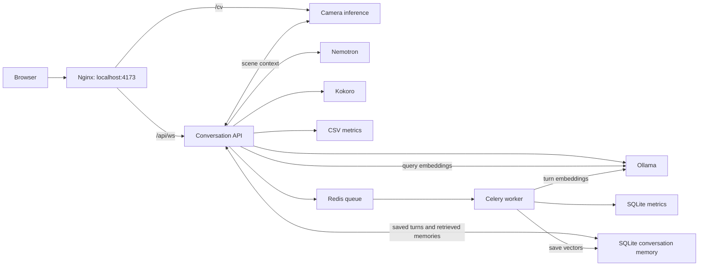

# Virtual Human

Virtual Human is a browser-based 3D companion with push-to-talk conversation,
automatic speech playback, lip synchronization, gestures, and optional camera
understanding. The Docker demo uses Ollama, Nemotron streaming STT, and Kokoro locally.
Celery and Redis save background metrics and index conversation memory.
SQLite, local embeddings, and hybrid reranking provide persistent recall.
See the [memory guide](docs/memory.md). No sign-in is required.

## Start the demo

Use Docker Desktop with Linux containers, NVIDIA GPU support, and Compose 2.24
or newer. Initial
setup downloads container images and model weights. Run these commands from
the repository root.

With NVIDIA GPU support in Docker:

```powershell
docker compose up --build -d
```

The root entry includes GPU access for Nemotron, Ollama, Kokoro, and the
backend. The current Nemotron deployment is verified with NVIDIA CUDA.

Compose downloads the Nemotron English 0.6B model through `nemotron-init`.
The model stays in the `nemotron-models` volume for later starts. The backend
waits for Nemotron to become ready, then connects over the internal Docker
network. A separate speech server on the host is not required.

Open **http://localhost:4173** after startup. Allow microphone access, hold
Space to speak, then release it. The reply audio plays automatically. Allow
camera access when you want visual context.

Check startup progress or stop the stack:

```powershell
docker compose ps -a
docker compose logs -f ollama-init nemotron-init nemotron backend cv worker
docker compose down
```

The model initializer containers should finish with exit code 0. `down`
retains named volumes. `down -v` deletes stored models and data.

To start or rebuild only the backend and its dependencies:

```powershell
docker compose up -d backend
docker compose up -d --build backend
```

Use `backend` as the service name, without a `--` prefix.

Windows users can start the default GPU setup with
`.\devops\Start-VirtualHuman.ps1`. Use `-Rebuild` to rebuild or `-Stop` to stop it.
See [Docker setup](docs/docker.md) for the complete procedure.

## Project structure

```text
virtual-human/
|-- backend/             Python API, model adapters, camera inference, tests
|-- frontend/            Browser UI, avatar playback, static assets, tests
|-- devops/              Dockerfiles, Compose services, Nginx, startup script
|-- docs/                Setup, configuration, architecture, troubleshooting
|-- TalkingHead/         Shared avatar assets, catalog, and upstream library
|-- docker-compose.yml  Root entry for the GPU demo
|-- README.md            Start here
`-- CHANGELOG.md         Changes and validation history
```

| Folder | Guide | What belongs here |
|---|---|---|
| `backend/` | [Backend README](backend/README.md) | Python application code, provider settings, scripts, and tests |
| `frontend/` | [Frontend README](frontend/README.md) | Browser code, UI styling, public assets, and JavaScript tests |
| `devops/` | [DevOps README](devops/README.md) | Container builds, service wiring, reverse proxy, and deployment launcher |
| `docs/` | [Documentation index](docs/README.md) | Detailed procedures and design explanations |
| `TalkingHead/` | [TalkingHead README](TalkingHead/README.md) | Shared avatar assets and upstream reference material |

Each maintained application subfolder has a `README.md` describing its role.
The vendored Supertonic code keeps its [existing documentation](backend/supertonic/README.md).

Local folders such as `.venv/`, `.vscode/`, model caches, `node_modules/`, and
`dist/` contain tools, settings, or generated files. They are not application
modules. `.env` files hold local configuration and must stay out of Git.
Old authentication folders and cache-only service folders have been removed.

## How the services connect



Only the frontend publishes a host port. Celery handles metrics persistence and
conversation embedding jobs through Redis;
live speech and camera processing use their own services. Camera preview and
camera inference have separate connection status.

## Conversation memory

Completed turns are saved in SQLite. On reconnect, the backend restores the
latest eight turns and the saved speech-rate preference. For each new request,
retrieval-augmented generation (RAG) supplies relevant older conversation data:
local `all-minilm` embeddings and FTS5 keyword search find candidates, then a
hybrid reranker selects up to four excerpts within a 6,000-character budget.
The reranker considers relevance, recency, corrections, and duplicates.
Current camera observations take priority over historical camera statements.

Memory persists across backend restarts in the `backend-data` Docker volume.
The default retention limit is 2,000 turns per conversation. The browser saves
its conversation ID in local storage, so tabs in the same browser profile share
memory. A different profile starts separate memory. Clearing browser storage
removes the link to saved conversations. Earlier history already lost from RAM
cannot be recovered.

Celery indexes saved turns in the background. Redis receives row IDs, while
conversation text stays in the shared SQLite database. Embeddings use CPU
inference. If embeddings are unavailable, retrieval falls back to keyword
search. Recall is selective and does not guarantee every answer.

For an existing installation, download the embedding model, rebuild the changed
services, and reload the browser:

```powershell
docker compose exec -T ollama ollama pull all-minilm
docker compose up --build -d backend worker talking-avatar
```

Set the `memory` block in the active backend configuration to change retention,
retrieval limits, the embedding model, or its timeout. `MEMORY_ENABLED=false`
disables persistence and retrieval; `MEMORY_DB_PATH` overrides the database path.
See the [memory guide](docs/memory.md) for all settings and failure behavior.

## Recorded validation

The Nemotron Compose integration passed nine provider tests and two model
download tests. A live check sent a Kokoro-generated WAV through the backend
STT provider and returned: "Hello, my name is Alex. The weather is sunny today".
Nemotron used CUDA, and the frontend API health route reported the configured
Nemotron provider. This check verifies service integration with generated
speech; microphone and noisy-room recognition were not tested in this check.

The memory update passed **349 backend tests** and **113 frontend tests**.
One backend test was skipped; seven backend subtests also passed. Backend and
frontend Docker builds passed, and a real Redis/Celery job saved an embedding.

Local Qwen 3.5 4B recalled an old number and a corrected breakfast preference
after 12 unrelated turns and recreation of the conversation objects. These two
checks confirm the tested scenarios, not universal recall or response speed.
See the [memory evaluation](docs/prompt-evaluation/2026-11-08/memory.md),
[prompt evaluation](docs/prompt-evaluation/2026-11-08/README.md), and
[performance benchmarks](docs/benchmarks/2026-11-08-qwen4b/README.md).

## Configuration and development

Docker reads `backend/config.docker.yaml` when the image is built. Host
processes read `backend/config.yaml`. Rebuild the Docker image after changing
its configuration. When changing the Ollama model, also update `ollama-init`
in `devops/compose.yaml`.

The host settings differ from Docker and require configured model services.
Follow [development and verification](docs/development.md) before running the
API or frontend directly on the host.

| Task | Guide |
|---|---|
| Start, stop, and inspect Docker services | [Docker setup](docs/docker.md) |
| Set models, speech speed, or storage | [Configuration and stored data](docs/configuration.md) |
| Run on the host or execute tests | [Development and verification](docs/development.md) |
| Understand conversation and camera processing | [Runtime architecture](docs/architecture.md) |
| Understand speech and gesture timing | [Audio and gesture synchronization](docs/audio-gesture-synchronization.md) |
| Configure persistent recall and reranking | [Conversation memory](docs/memory.md) |
| Resolve startup, camera, or speech problems | [Troubleshooting](docs/troubleshooting.md) |
| Review changes and recorded test results | [Changelog](CHANGELOG.md) |

Local demo changes are credited to **Bhvan Madhusudhan**. Upstream contributions
and their authors remain identified in the changelog and vendored documentation.
