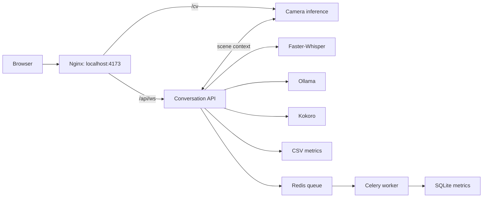

# Virtual Human

Virtual Human is a browser-based 3D companion with push-to-talk conversation,
automatic speech playback, lip synchronization, gestures, and optional camera
understanding. The Docker demo uses Ollama, Faster-Whisper, and Kokoro locally.
Celery and Redis save background metrics. No sign-in is required.

## Start the demo

Use Docker Desktop with Linux containers and Compose 2.24 or newer. Initial
setup downloads container images and model weights. Run these commands from
the repository root.

With NVIDIA GPU support in Docker:

```powershell
docker compose up --build -d
```

For CPU-only operation:

```powershell
docker compose -f devops/compose.yaml up --build -d
```

Keep `-f devops/compose.yaml` in later Compose commands when using CPU only.
The root entry includes the GPU configuration by default.

Open **http://localhost:4173** after startup. Allow microphone access, hold
Space to speak, then release it. The reply audio plays automatically. Allow
camera access when you want visual context.

Check startup progress or stop the stack:

```powershell
docker compose ps -a
docker compose logs -f ollama-init speech-init backend cv worker
docker compose down
```

The model initializer containers should finish with exit code 0. `down`
retains named volumes. `down -v` deletes stored models and data.

Windows users can start the default GPU setup with
`.\devops\Start-VirtualHuman.ps1`. Use `-Rebuild` to rebuild or `-Stop` to stop it.
See [Docker setup](docs/docker.md) for the complete procedure.

## Project structure

```text
virtual-human/
|-- backend/             Python API, model adapters, camera inference, tests
|-- frontend/            Browser UI, avatar playback, static assets, tests
|-- devops/              Dockerfiles, Compose services, Nginx, startup script
|-- docs/                Setup, configuration, architecture, troubleshooting
|-- TalkingHead/         Shared avatar assets, catalog, and upstream library
|-- docker-compose.yml  Root entry for the GPU demo
|-- README.md            Start here
`-- CHANGELOG.md         Changes and validation history
```

| Folder | Guide | What belongs here |
|---|---|---|
| `backend/` | [Backend README](backend/README.md) | Python application code, provider settings, scripts, and tests |
| `frontend/` | [Frontend README](frontend/README.md) | Browser code, UI styling, public assets, and JavaScript tests |
| `devops/` | [DevOps README](devops/README.md) | Container builds, service wiring, reverse proxy, and deployment launcher |
| `docs/` | [Documentation index](docs/README.md) | Detailed procedures and design explanations |
| `TalkingHead/` | [TalkingHead README](TalkingHead/README.md) | Shared avatar assets and upstream reference material |

Each maintained application subfolder has a `README.md` describing its role.
The vendored Supertonic code keeps its [existing documentation](backend/supertonic/README.md).

Local folders such as `.venv/`, `.vscode/`, model caches, `node_modules/`, and
`dist/` contain tools, settings, or generated files. They are not application
modules. `.env` files hold local configuration and must stay out of Git.
Old authentication folders and cache-only service folders have been removed.

## How the services connect



Only the frontend publishes a host port. Celery handles metrics persistence;
live speech and camera processing use their own services. Camera preview and
camera inference have separate connection status.

## Configuration and development

Docker reads `backend/config.docker.yaml` when the image is built. Host
processes read `backend/config.yaml`. Rebuild the Docker image after changing
its configuration. When changing the Ollama model, also update `ollama-init`
in `devops/compose.yaml`.

The host settings differ from Docker and require configured model services.
Follow [development and verification](docs/development.md) before running the
API or frontend directly on the host.

| Task | Guide |
|---|---|
| Start, stop, and inspect Docker services | [Docker setup](docs/docker.md) |
| Set models, speech speed, or storage | [Configuration and stored data](docs/configuration.md) |
| Run on the host or execute tests | [Development and verification](docs/development.md) |
| Understand conversation and camera processing | [Runtime architecture](docs/architecture.md) |
| Understand speech and gesture timing | [Audio and gesture synchronization](docs/audio-gesture-synchronization.md) |
| Resolve startup, camera, or speech problems | [Troubleshooting](docs/troubleshooting.md) |
| Review changes and recorded test results | [Changelog](CHANGELOG.md) |

Local demo changes are credited to **Bhvan Madhusudhan**. Upstream contributions
and their authors remain identified in the changelog and vendored documentation.
