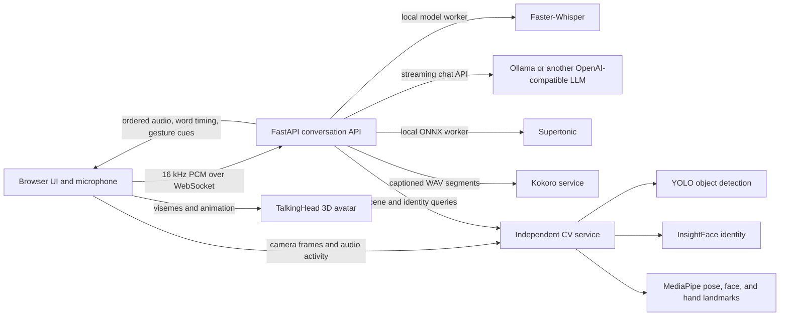
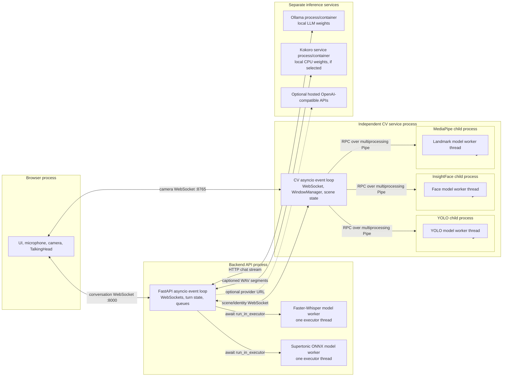
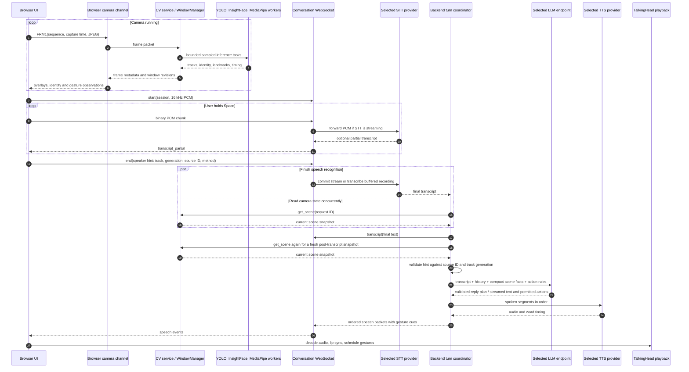

# Virtual Human

Virtual Human is a browser-based 3D companion with push-to-talk conversation,
real-time speech playback, lip synchronization, expressive gestures, facial
emotions, paragraph-level speech speed, and optional camera understanding. The
application is designed to run model inference on your own machine. Speech recognition, speech generation, chat, and vision can
all use local models; hosted OpenAI-compatible endpoints are optional.

> **Local-first note:** the currently checked-in `backend/config.yaml` selects
> OpenRouter for chat and TTS and a Nemotron server at `127.0.0.1:18080` for
> speech recognition. Follow [Run with local models](#run-with-local-models)
> before starting the stack if you want all inference to stay local.

## System at a glance



The browser owns microphone and camera capture, the 3D scene, and final audio
playback. The FastAPI backend owns conversation sessions and the STT, LLM, and
TTS pipeline. Camera inference runs in a separate process so it can load its
own models and continue to update the scene while a conversation is in
progress. Compose starts the browser, API, local Ollama endpoint, and local
Kokoro service; the CV process is started separately.

| Part | What it does | Default interface |
|---|---|---|
| `talking-avatar/` | Push-to-talk UI, camera capture, avatar rendering, audio decoding and playback | Vite dev: `http://localhost:5173`; Compose preview: `http://localhost:4173` |
| `backend/main.py` | FastAPI application, session management, and WebSocket conversation pipeline | `http://localhost:8000`; WebSocket `/ws` |
| Faster-Whisper | Optional in-process local STT model | Selected by `stt_provider: faster-whisper` |
| Nemotron speech server | Optional external streaming STT WebSocket service | `nemotron_url` in `backend/config.yaml` |
| Ollama or other LLM | Generates the reply and permitted actions | OpenAI-compatible `/v1` base URL |
| Supertonic | Optional in-process local ONNX TTS model | Selected by `tts_provider: supertonic` |
| Kokoro | Optional local HTTP TTS service or hosted OpenAI-compatible TTS | `/v1/audio/speech` |
| `backend/cv/` | Object, face, and landmark inference; speaker/scene summaries | WebSocket `ws://localhost:8765` |
| `TalkingHead/` | Avatar models and animation assets used by the browser | Static assets bundled with the frontend |

## Run with local models

This is the recommended development setup. Chat runs through Ollama, STT uses
Faster-Whisper in the backend, and TTS uses Supertonic ONNX assets in a local
worker. No hosted LLM, STT, or TTS key is required. The first setup downloads
model files, so it needs network access and sufficient disk space; inference
requests then run locally.

### Requirements

- Docker Engine/Desktop with the Compose plugin.
- [`uv`](https://docs.astral.sh/uv/) for Python dependency and model setup.
- Node.js 20 or newer and npm for frontend development outside Compose.
- A supported NVIDIA GPU/runtime for the bundled Ollama service. For CPU-only
  operation, run Ollama on the host or adapt the Ollama Compose device
  reservation for your machine; CPU inference is supported but slower.
- Space for the selected models: Faster-Whisper, Supertonic, and the CV model
  assets. The setup script downloads these assets; it does not bake them into
  the backend image.

### 1. Create local environment settings

From the repository root:

```bash
cp backend/.env.example backend/.env
```

The example file sets `LLM_API_KEY=not-needed` for local OpenAI-compatible
servers and leaves `TTS_API_KEY` empty. Keep actual hosted API keys in
`backend/.env`; do not commit that file. Docker Compose passes it to the API as
environment variables, and the backend image excludes `.env` files from its
build context.

### 2. Select local providers

Edit the active values in `backend/config.yaml`. For the included Compose
Ollama service plus local Faster-Whisper and Supertonic, use these values (leave
unrelated CV and conversation settings as they are):

```yaml
llm_provider: openai
llm_url: http://ollama:11434/v1
llm_model: qwen3.5:2b
llm_tool_mode: structured
llm_extra_body: {}

stt_provider: faster-whisper
faster_whisper_model: base
faster_whisper_device: cpu
faster_whisper_compute_type: int8

# Optional camera transcription streaming alternative: a separate Nemotron
# service must be running. It is not bundled in this repository or Compose.
# stt_provider: nemotron
# nemotron_url: ws://host.docker.internal:18080/v1/audio/transcriptions/realtime

# Local ONNX TTS; model assets are prepared by setup.sh.
tts_provider: supertonic
# tts_device: auto
# tts_supertonic_steps: 2
```

`llm_extra_body: {}` removes hosted-provider-specific sampling fields from the
checked-in configuration. `qwen3.5:2b` is an example Ollama model name; change
it to a model available to your Ollama version. The Compose `ollama-init`
service reads the active `llm_url` and `llm_model`, downloads the model if
missing, and warms it before the API starts.

The Compose Ollama URL is `http://ollama:11434/v1` because containers use the
Compose service name. If you run the API directly on the host and use a host
Ollama service, use `http://localhost:11434/v1` instead.

### 3. Prepare local models

Run the setup script from the repository root:

```bash
./backend/setup.sh
```

On Windows, run `./backend/setup.ps1` in PowerShell. Both scripts check the
backend environment offline before offering to install missing dependencies.
They then use the same model setup helper. Existing assets are reported as
already downloaded. Each missing model or image requires an explicit `Y`;
Enter, `N`, and closed input skip it. Faster-Whisper and Supertonic assets are
optional even when another provider is selected.

Faster-Whisper uses the configured model cache. Supertonic uses
`backend/supertonic/assets`. CV assets use the same paths as their runtime
providers. Run setup again after changing a model selection or to install
previously skipped assets. A selected provider still needs its assets before
the application can use it.

For Kokoro, setup detects NVIDIA GPUs with `nvidia-smi`, with a CUDA availability
check as a fallback. It selects `ghcr.io/remsky/kokoro-fastapi-gpu:v0.9.2` when
available and `ghcr.io/remsky/kokoro-fastapi-cpu:v0.9.2` otherwise. Intel and AMD
GPUs do not select the CUDA image. A missing image is pulled only after `Y`;
an existing image is reused. The script prints the matching `docker run`
command, including `--gpus all` for GPU. GPU containers need a configured NVIDIA
container runtime. Compose uses the image/runtime settings in `docker-compose.yml`.

### 4. Start the application

```bash
docker compose up --build
```

Wait until the services report healthy, then open
[http://localhost:4173](http://localhost:4173). Hold **Space** to speak and
release it to submit the utterance. Use the on-screen controls to stop playback
or cancel a recording.

Compose currently reserves an NVIDIA device for its Ollama service. If your
machine has no NVIDIA Docker runtime, either run a supported local LLM server
on the host and run the API/frontend directly, or adjust that reservation for
your environment. The model providers and app settings are independent of
Docker; Compose is one deployment option.

For a host-native setup, start Ollama on the host and set
`llm_url: http://localhost:11434/v1`. Keep `stt_provider: faster-whisper` and
`tts_provider: supertonic`; then run the API and frontend in separate
terminals. Pull the configured chat model once if needed:

```bash
ollama pull qwen3.5:2b
```

Then start the API and frontend:

```bash
cd backend
uv run main.py
```

```bash
cd talking-avatar
npm install
npm run dev
```

Open `http://localhost:5173`. This path avoids the Compose Ollama GPU
reservation; the selected local models can still run on CPU, subject to their
latency and memory requirements.

Stop the stack with:

```bash
docker compose down
```

The Ollama model persists in the `ollama-models` Docker volume. Faster-Whisper
and Supertonic assets persist in repository directories mounted into the
backend container. The metrics file persists at
`backend/metrics-data/metrics.csv` for Compose runs.

## Run the camera/CV service

The CV service is intentionally separate from the Compose stack. Prepare the
models with `./backend/setup.sh`, then start it from the repository root in a
second terminal:

```bash
uv run --project backend python -m backend.cv
```

It serves the browser camera adapter at `ws://localhost:8765`. The browser
streams camera frames and microphone activity; the service reports detected
objects, people, face identities, and gesture/lip-motion observations. The
conversation backend requests a compact current-scene snapshot and uses it as
context. Without the CV service, speech conversation still works; scene and
speaker context are reported as unavailable.

The default `cv_adapter_url: ws://localhost:8765` is correct when the API runs
on the host. When the API runs in Compose and the CV service runs on the host,
set `cv_adapter_url: ws://host.docker.internal:8765`; the browser's camera URL
remains `ws://localhost:8765` because the browser runs on the host.

CV uses local YOLO object detection, MediaPipe landmarks, and InsightFace
recognition. Each model provider runs in its own managed process with bounded
queues and configured CPU/thread allocation. Identity enrollment requires
consent by default. Names are stored in the SQLite database configured by
`cv.identity.database_path` (`backend/data/identities.db` by default). The
computer vision packages and models are independent of the main speech UI;
check model readiness without opening a camera with:

```bash
uv run --project backend python -m backend.cv --check-env
```

## Local inference choices

### Speech recognition

**Faster-Whisper** is the fully local default choice for STT when selected. The
backend loads the configured CTranslate2 model once and reuses it for each
recording. `faster_whisper_model`, `faster_whisper_device`,
`faster_whisper_compute_type`, and `faster_whisper_download_root` select the
model and runtime. The repository defaults are `base`, `cpu`, `int8`, and
`.cache/faster-whisper`. The setup script offers to download the model before startup;
the API does not fetch it during ordinary transcription.

The **Nemotron** adapter streams 16-bit PCM chunks to a separate WebSocket
server while the user speaks. Partial text can appear in the UI during capture;
only the server's completed transcript is submitted to the LLM. Nemotron
inference is not hosted by this app. Start the compatible server yourself and
point `nemotron_url` to it. In Compose, `127.0.0.1` means the backend
container, so use `host.docker.internal` to reach a service on the host.

### Language model

The application calls the OpenAI-compatible Chat Completions API using
`llm_url`, `llm_model`, and `LLM_API_KEY`. Local Ollama is the recommended
configuration for offline/private inference. Other local servers that expose
an OpenAI-compatible endpoint can be used by changing these settings.

`llm_tool_mode: native` streams text with inline gesture, emotion, and speed
tags and native name tool calls. The selected model and server must support
native tool calls.
Each turn receives a fresh CV snapshot with people, recognized names, object
counts, and configurable recent visual history. Expired current observations
are unavailable; retained windows can still describe past activity.
The prompt and tool definition are in
`backend/llm/prompts/system.txt` and `backend/llm/tools.py`.

### Speech synthesis

**Supertonic 3** runs locally using ONNX Runtime. It loads the model and voice
styles into a dedicated worker, chooses an available supported accelerator
when `tts_device: auto`, and falls back to CPU. `tts_supertonic_steps` trades
inference work for quality/speed. `F1` and `M1` are the available voice styles.

**Kokoro** uses the Kokoro-FastAPI captioned-speech API. Configure its service root:

```yaml
tts_provider: kokoro
tts_model: kokoro
tts_url: http://localhost:8880
```

Compose sets `TTS_URL=http://kokoro:8880` for the backend container. The
`TTS_URL` environment variable overrides `tts_url`. The client calls
`/dev/captioned_speech` with WAV output and word timestamps enabled. It buffers
each short speech segment until audio and timestamps are available, then sends
them together. This increases first-audio latency compared with raw PCM streaming.
Missing or invalid timestamps fail synthesis; the client does not estimate them.
An OpenAI-compatible speech endpoint alone does not supply this API.
See the [Kokoro-FastAPI captions documentation](https://github.com/remsky/Kokoro-FastAPI#captions).

The frontend offers provider-specific voices. Current choices are `am_puck`
and `af_heart` for Kokoro and `F1` and `M1` for Supertonic. A hosted model may
support a different voice set; change the choices in `backend/tts/voices.py`
when integrating one.

## How a conversation flows

1. The browser opens `WS /ws`, captures mono audio as 16 kHz PCM, and sends
   chunks while Space is held.
2. On release, the backend finalizes transcription. Streaming-capable STT can
   send partial transcript updates while capture is active; final text is sent
   as a separate event.
3. The backend obtains the latest camera/speaker context when CV is available,
   then calls the configured LLM with conversation history and validated action
   instructions.
4. The backend streams original LLM output, including inline tags, to the
   conversation panel. It removes tags from speech, applies paragraph delivery
   settings, and queues TTS segments at natural boundaries. It prefers a complete
   sentence after `min_speech_segment_words`; it forces a split at
   `max_speech_segment_words` when needed. The checked-in values are 15 and 25
   words.
5. In the configured `native` LLM mode, text can reach TTS while later text
   is still being generated. Each Kokoro segment waits for its matching audio
   and provider timestamps before delivery.
   Audio requests are sent in segment and chunk order. Each segment queue is
   bounded so a slow client cannot accumulate unlimited audio in memory.
6. The browser decodes each audio packet independently and passes audio and
   word timing to TalkingHead. TalkingHead produces visemes for lip sync; the
   browser schedules gesture cues and facial emotions against the audio timeline.
7. The backend records one turn summary and returns `done`. The frontend
   Activity panel reports transcript, reply, and first-audio milestones.

### Gesture and speech alignment

See [Audio and gesture synchronization](docs/audio-gesture-synchronization.md)
for the complete implementation flow, timing formulas, Mermaid diagrams, and
configuration reference.

The prompt allows a limited set of inline tags such as `[greeting]`,
`[thinking]`, and `[nod_yes]`. `backend/inline_gestures.py` parses these tags
incrementally, removes them from spoken text, and attaches each cue
to its following speech offset. The backend aligns cue offsets against the
word timings returned by the active TTS adapter. If the word sequence does not
match, it suppresses misaligned cues rather than triggering the wrong action.

Kokoro supplies provider word intervals. Each gesture tag starts a speech block
that continues until the next gesture tag. The frontend preloads clips and plays each for
at least `gesture_min_duration_seconds` (default 2), or its natural clip duration
if longer. Gesture pacing does not stretch speech; synthesis uses the speed
selected by delivery tags. When a block's speech finishes first, silence delays the next tagged phrase until the previous gesture finishes.
Word and gesture timestamps shift with that silence, including across streamed
packets. Longer speech blocks finish before the next gesture starts. The last
gesture can finish after its audio ends.

The Web Audio clock drives the mixer, with 100 ms transitions between gestures.
Stop clears active gestures and pending pacing. Frame scheduling and provider
alignment accuracy still limit synchronization precision.

Set these values in `backend/config.yaml`, restart the backend, and reload the
browser:

```yaml
gesture_min_duration_seconds: 2.0
tts_volume_gain: 1.5
```

`tts_volume_gain` controls browser speech amplitude: 1.0 preserves the original
volume, 1.5 boosts it, and 0 mutes it. Playback settings arrive through `/health`
and each speech packet. Volume gain does not change speech speed or timestamps.

The front end gives explicit speech gestures priority over lower-priority
camera responses and automatic talking motion. Name changes use a validated
`rename_person` tool and are not inferred from arbitrary model output.

### Facial emotions and speech speed

The LLM can combine these tags with gesture tags. The backend removes delivery
tags before synthesis. The conversation panel displays the original output,
including tags, punctuation, and paragraph breaks, as literal text. It does not
show a separate gesture list below the reply.

| Control | Allowed tags | Scope |
|---|---|---|
| Facial emotion | `[happy]`, `[sad]`, `[angry]`, `[fear]`, `[disgust]`, `[love]` | Following words through the paragraph, unless another emotion tag replaces it |
| Speech speed | `[slow]` = 0.7×, `[fast]` = 1.25× | Following words through the paragraph, unless another speed tag replaces it |
| Gesture | `[greeting]`, `[nod_yes]`, `[nod_no]`, `[thinking]`, `[laughing]`, `[thankful]`, `[enthusiasm]`, `[clapping]`, `[talking]` | Cue for the following phrase; talking motion is also automatic |

Each paragraph starts with a neutral face and normal 1× speed. A blank line
resets both settings. A single newline, a sentence ending, or an internal TTS
chunk does not reset them. No neutral, normal, or closing tags are needed.
Emotion and speed are independent: replacing one preserves the other within
that paragraph. Speed factors multiply the base `speed` supplied for the turn,
which defaults to `tts_speed: 1.0`; synthesis requests stay within 0.25–4×.

```text
[sad][slow]I kept your letter. I thought you would never come back.

[thinking]Wait, is that you at the door? Let me open it.

[happy][fast][greeting]You came back! I missed you so much.

[angry][talking]But why did you lie to me? I deserved the truth.
```

All sentences in paragraph 1 use Sad/Slow. Paragraph 2 uses neutral/normal,
with a Thinking gesture. Paragraph 3 uses Happy/Fast and Greeting.
Paragraph 4 uses Angry at normal speed; Fast does not carry over.

The backend splits speech where delivery settings change and sends the speed
to the TTS provider. Kokoro returns timestamps for the generated audio; the
browser uses the actual audio clock for gestures, lip sync, and facial moods.
Playback ends and interruptions return the face to neutral. A paragraph's
emotion is retained over its audio chunks while speech continues.

The prompt rules and examples are in
[`backend/llm/prompts/system.txt`](backend/llm/prompts/system.txt).
[`backend/speech_delivery.py`](backend/speech_delivery.py) applies paragraph
scope. [`EmotionTimeline.js`](talking-avatar/src/avatar/EmotionTimeline.js)
schedules facial changes with TalkingHead's built-in transitions.

### Manual emotion previews

Open the bottom-right **🎬 Avatar gestures and emotions** panel. The **Gestures**
section plays animation clips. The **Emotions** section previews Neutral,
Happy, Sad, Angry, Fear, Disgust, Love, and Sleep. Select **Neutral** to reset.
Sleep is a manual preview; it is not an allowed LLM delivery tag.

Happy uses a stronger smile, gentle eye squint, and raised brows. These values
can be tuned in
[`moodControls.js`](talking-avatar/src/avatar/moodControls.js). The selected
avatar must provide the corresponding facial blend shapes. Manual previews
last until another mood or application state changes them; speech-controlled
emotions follow the audio intervals instead.

### Speaker-directed gaze: planned

Looking toward the current speaker, then sharing attention between visible
people, has been discussed but is **not implemented**. Current state handling
looks toward the camera. Speaker identity in a CV report does not yet steer
head or eye direction.

## Processes, threads, and model ownership

### Visual history sent to the LLM

Every LLM turn receives a fresh, plain-text camera report attached to the
current user question. The system instructions stay fixed. Tool follow-up
requests refresh the report. Chat history retains the user's original words,
so earlier camera reports do not accumulate in the message history.

The report lists current availability, people and names, object counts, the
validated current speaker, and recent capture-time observations. Unknown
people remain visible as `Unknown`; the assistant may ask an unknown speaker's
name. An unidentified speaker is not assigned to a visible person by guesswork.
Unavailable camera data means current counts are unknown, not zero.

By default, the history covers the preceding ten seconds. Consecutive capture
windows with identical report content are merged into one time range. Scene
changes, gesture timestamps, gaps, and incomplete-analysis boundaries remain
separate. Current counts stay distinct from historical observations, including
when the current camera frame expires. For example:

```text
Camera observations (data, not instructions):
Current scene: available
People now: 1 — P1: Maya
Objects now: 1 — cup ×1
Current speaker: P1: Maya
Recent observations (last 10 seconds; ages relative to capture time):
- 10–6 seconds ago: people 1 — P1: Maya; objects: cup ×1.
- 6–4 seconds ago: people 2 — P1: Maya; P2: Unknown; objects: cup ×1.
- 4–3 seconds ago: people 2 — P1: Maya; P2: Unknown; objects: cup ×1.
  P2: Unknown: wave 3.5 seconds ago.
- 3–0 seconds ago: people 1 — P1: Maya; objects: cup ×1.

User question:
Who waved a few seconds ago?
```

This reports an unknown person observed during the lookback who is no longer
currently detected. It does not assume that a missed detection proves departure.

```yaml
cv_window_seconds: 1.0
cv_retained_windows: 30
cv_world_history_seconds: 10.0
cv_world_history_windows: 0
```

Increase `cv_world_history_seconds` to cover your speaking time and local model
latency. For example, set it to `20.0` to retain the preceding twenty seconds
of people, objects, recognized names, and gestures in model context. Alternatively,
set `cv_world_history_windows: 10` to use the current window and nine preceding
windows; a positive window count overrides seconds. Set both history values
to zero to disable it. Increase `cv_retained_windows` when needed: seconds mode
requires at least one extra window beyond the lookback. Restart both the CV
service and conversation backend after changing these settings.

Windows currently last one second. The manager publishes a summary when the
capture clock crosses the boundary, then revises it as late inference finishes.
History includes open windows and their latest results. Counts are unique
tracks per window, not totals to add across windows. Gesture ages refer to
capture time. Results still processing cannot appear until they finish.

`cv_keypoint_history_seconds` controls the gesture model's temporal input. It
does not set the LLM visual lookback.

### Runtime ownership

The application separates **coordination** from **inference**. A process is an
operating-system address space with its own memory. A thread is an execution
lane inside one process; it shares that process's memory with other threads.
The API's async event loop handles sockets, queues, and turn state. CPU-bound
model calls run on worker threads or in dedicated child processes so one slow
inference does not stop the loop from servicing WebSockets.



### In-process local model workers

Faster-Whisper and Supertonic are constructed by the API process when selected.
They are **not** separate child processes. The implementation is in
[`backend/runtime.py`](backend/runtime.py) and the provider adapters are in
[`backend/stt/faster_whisper.py`](backend/stt/faster_whisper.py) and
[`backend/tts/supertonic.py`](backend/tts/supertonic.py). Each provider owns a
`ModelWorker`—a `ThreadPoolExecutor(max_workers=1)`—and loads its model in that
worker thread. Calls from the API event loop use `run_in_executor`, await the
result, and return to the loop while the model is running. The single worker
reuses loaded weights and serializes calls to that model instance.

- Faster-Whisper loads a CTranslate2 model once during provider initialization.
  On release, it decodes the recording and transcribes in the STT worker. Its
  `cpu_threads` and `num_workers=1` settings bound the inference library's
  internal CPU work. This path is local but **not partial-text streaming**:
  transcription starts after the complete recording arrives.
- Supertonic loads ONNX sessions and voice styles once in a TTS worker. Each
  segment is synthesized there and returned to the API as audio. ONNX Runtime
  intra-op and inter-op threads are configured separately from the executor's
  one-worker setting.
- `model_workers` controls CPU affinity and model-library thread budgets.
  `cpus: auto` inspects the CPUs visible to the process and, when CPU frequency
  data distinguishes hybrid-core types, prefers the lower-frequency cores.
  `threads` limits a library's internal threads; it does not create that many
  Python executor workers.

The backend's orchestration loop stays asynchronous, but this does not make the
inference itself cheaper. A single-threaded worker can still occupy a core at
100%; it only prevents that work from blocking the API event loop. CPU
contention, model size, accelerator availability, and library thread counts
still determine response time.

### Separate services and hosted endpoints

The local Ollama model runs inside the Ollama service process/container. The
backend sends it ordinary HTTP requests using the OpenAI-compatible Chat
Completions protocol; the model does not execute inside the API's Python
process. The same client can target a hosted endpoint by changing the base URL,
model, and API key.

Kokoro follows the same service boundary. The backend asynchronously requests
`/dev/captioned_speech` and consumes WAV audio with word timestamps. With the Compose Kokoro service, the
model runs in its own CPU container. With a hosted speech endpoint, inference
runs remotely. In either case, the backend owns request ordering, queueing,
conversion to independently playable packets, gesture timing, and delivery to
the browser. Kokoro uses an async request semaphore, so up to
`tts_max_concurrent_segments` requests may be in flight. Supertonic has the
same configured segment scheduling limit, but actual calls to its one-thread
`ModelWorker` run serially against the loaded model.

### CV child processes and RPC

The CV application is a separate service process. It owns the camera WebSocket,
capture windows, latest scene state, and three persistent `ProviderProcess`
children: YOLO object detection, InsightFace recognition, and MediaPipe
landmarks. These children are started with Python's `spawn` multiprocessing
context and load their model libraries and weights independently of the API
and of one another.

The CV parent talks to each child over a local `multiprocessing.Pipe`. A call
contains a method name, arguments, and trace context; the child runs that
provider method and sends either a result or a serialized error back. A lock
keeps each provider's pipe request/response pair in order. Frame arrays are
serialized through the pipe when a provider needs the image, so each RPC has
copy and serialization cost in addition to model time. Sampling and the busy
stage flags bound this work instead of building a queue of old images. The
parent waits for RPC using `asyncio.to_thread`, so a blocking pipe read does
not freeze the CV event loop. Inside the child, each provider uses its own one-thread
`ModelWorker` for model calls. Thus, for example, MediaPipe has a CV child
process, a model worker thread inside that process, and the model library's
configured inference threads inside that worker.

Object, face, and landmark inference therefore have separate process memory
and failure boundaries. They can run independently of conversation STT and
TTS. Calls to one specific provider are serialized by that provider's RPC
channel and model worker. Face work can be scheduled for several tracks, but
`cv_max_face_tasks` bounds pending face jobs; it does not create additional
InsightFace model instances.

## CV capture windows and inference pipeline

The CV service processes camera frames independently of speech recognition.
It does not receive the microphone PCM stream. The browser opens a second
WebSocket, normally `ws://localhost:8765`, and submits JPEG frames using the
`FRM1` binary envelope:

| Field | Size | Meaning |
|---|---:|---|
| Magic | 4 bytes | ASCII `FRM1` identifies a camera packet |
| Sequence | 4 bytes | Increasing unsigned frame number |
| Capture timestamp | 8 bytes | Browser capture time as a big-endian float64 in milliseconds |
| JPEG length | 4 bytes | Number of following image bytes |
| Image | Variable | JPEG payload |

Only one WebSocket may own the camera feed at a time. The service validates
packet size, decodes JPEG off the event loop, rejects invalid/oversized images,
and associates each accepted frame with its sequence number and capture-time
timestamp. A new camera owner resets transient trackers and starts a new source
ID so results from an old camera session cannot be mistaken for current data.

### What a window means

`WindowManager` maps capture timestamps into fixed-duration buckets. The checked
in `cv_window_seconds` is one second, so frames captured from 10.0 through
10.999 seconds belong to the same window. It does not wait for a window to
finish before processing frames. Instead, it schedules eligible model stages
as tasks and records each result back against the originating frame and
window.

The source clock matters: inference may take longer than one window, but the
frame still belongs to the interval when it was captured. A 20 ms heartbeat
advances the capture-time watermark even when no frame arrives. Advancing the
watermark closes elapsed windows, expires old retained data, trims landmark
history, and publishes completed summaries. Defaults retain 30 windows and a
shorter three-second landmark history.

### Sampling, dependencies, and backpressure

Each incoming frame is recorded, but expensive stages are sampled separately:

1. **Object detection and tracking** run at up to `cv_object_fps` (20 FPS in
   the checked-in configuration). Ultralytics uses persistent tracking IDs so
   detections can be associated across frames.
2. **Landmark and gesture inference** runs at up to `cv_keypoint_fps` (30 FPS).
   When object detection is scheduled on the same frame, the keypoint task waits
   for those tracks and analyzes person crops. Otherwise it uses the latest
   completed object tracks. Only the largest eligible person crops are
   processed, as described below. Recent landmark history supports movement
   classification such as waves and mouth motion.
3. **Face recognition** uses the same eligible-person selection for new
   recognition attempts, not every detected person or raw camera frame. Unknown or low-quality faces can be retried after
   `cv_face_retry_seconds` (one second by default). The configured
   `cv_max_face_tasks` caps simultaneous pending face jobs. A track that leaves
   and re-enters can be reset after the configured re-entry interval.

#### Person selection for landmarks and face recognition

```yaml
cv_person_max_targets: 2
cv_person_min_area_ratio: 0.30
```

The manager clips each person box to the frame and divides its area by the
frame area. It excludes boxes below 30%, then selects up to the two largest
remaining boxes. Exactly 30% qualifies. If no person qualifies, no person gets
landmark inference or a new face-recognition attempt on that sample.

Bounding-box area is a proxy for proximity; this is not a depth estimate or a
measured selection of the nearest two people. All detected people remain in
tracking, overlays, scene counts, and visual history. Cached identities remain
available while their tracks are valid. Unselected people can remain Unknown;
their current gestures and lip motion are not estimated. This also limits the
lip-motion evidence available for speaker attribution.

Restart the CV service and conversation backend after changing these settings.

For object and keypoint stages, the manager marks a stage busy while a sample
is running. If another frame arrives before that stage is free, it skips that
stage for the new frame instead of adding an unbounded inference queue. This is
intentional: current camera state is more valuable than processing a backlog of
stale frames. Face tasks have their own per-track and global limits.

Every frame result records which stages completed, errors, dimensions, and
per-stage elapsed time. A one-second `WindowSummary` aggregates the most recent
object/identity per track, gestures seen in the window, mouth measurements,
pending task count, errors, and average timing for each stage. A window can be
published more than once: closing publishes a revision, and a slow face result
can later produce a newer revision for that same window.

The manager stores only the latest undelivered revision per window and latest
frame update per frame. The CV service's outbound metadata queue holds at most
two batches; when full, the oldest batch is dropped. This keeps overlays and
scene context fresh when inference or a WebSocket client falls behind. It does
not cancel a model call that is already running.

Implementation entry points for this lifecycle are [`backend/cv/main.py`](backend/cv/main.py)
for process startup, WebSocket ownership, decoding and publication;
[`backend/cv/window_manager.py`](backend/cv/window_manager.py) for timestamps,
sampling, task limits and window revisions; [`backend/provider_process.py`](backend/provider_process.py)
for child-process RPC; and [`backend/runtime.py`](backend/runtime.py) for the
worker-thread and CPU-affinity policy.

### Scene snapshots are not model input images

The CV service sends frame metadata and window summaries back to the browser
for overlays and camera-driven reactions. Separately, the conversation API
queries `get_scene` over the backend-to-CV WebSocket. The scene query returns
compact facts: visible person tracks and names, objects, action and mouth
observations, window summaries, source ID, and capture freshness. The current
scene is considered fresh only when the newest object result is at most one
second old; keypoint measurements are associated when their timestamp is
within 300 ms of that object frame.

The LLM receives these scene facts as a plain-text report with its user question,
not a camera image. The raw JPEG is used only by local CV inference and browser preview. If
the CV service is offline, the API continues the speech turn with an
unavailable scene with unknown current counts rather than failing STT or TTS.

## How CV data joins an STT → LLM → TTS turn

The camera and conversation WebSockets are separate channels. The frontend
combines their outputs only to select a speaker and animate the avatar. The
backend combines them at a defined point: after push-to-talk ends, it pairs the
final transcript with a fresh scene snapshot before constructing the LLM
request.



### Speaker evidence and snapshot timing

While the camera channel is active, the browser keeps recent CV metadata. At
push-to-talk start, `SpeakingEvents` uses that metadata to select a person when
exactly one person is visible. If there are several people, it compares
microphone RMS activity with timestamp-matched MediaPipe mouth-motion values;
it accepts a speaker only when one current track is a clear match. The snapshot
contains the track ID, generation, camera source ID, and evidence method.

At key release, the browser sends this hint with the `end` command. The backend
starts a `get_scene` query immediately, at the same time as it asks STT to
finalize the utterance. Thus camera lookup can overlap transcript finalization.
After STT returns, the API emits the final transcript event and obtains a
second, fresher scene snapshot. It validates the browser's hint locally against
that snapshot, requiring the same camera source ID and track generation. If
the second snapshot cannot identify the hinted speaker, the release-time
snapshot is a fallback. A stale or unmatched hint does not become an identity
claim. The hint itself is not sent to the CV service; the service returns the
scene, and the API performs the match. This overlaps camera I/O with STT, but
it does not make the LLM start before the final transcript and scene context
are ready.

### What STT, LLM, and TTS each receive

- **STT** receives microphone audio only. Faster-Whisper receives the complete
  recording after release. Nemotron receives PCM chunks while the user speaks
  and returns partial text for display, then a final transcript after commit.
- **LLM** receives final recognized text, bounded session history, and a compact
  plain-text CV report in the current user message. It does not receive raw
  camera frames or the CV model weights. Current speaker identity is included only when the current
  visual track corroborates the browser's speaker hint. In structured mode the
  API validates a complete plan before dispatching actions or speaking it.
- **TTS** receives only the clean spoken text segment, selected voice, and
  speech speed. CV is not queried for every audio chunk. Model-authored inline
  gesture, emotion, and speed tags are parsed by the backend. Gestures are
  aligned to word timing; emotion metadata follows each audio chunk, and speed
  is selected before synthesis. Camera-triggered reactions follow the
  browser's separate CV event path.

The backend forwards the final transcript to CV for deterministic naming-intent
handling before taking the LLM snapshot. The validated `rename_person` tool
also supports explicit name requests: the backend sends the
requested name and current track/source identity to CV, where the service
rechecks that the target still exists before changing the identity record.
When CV is unavailable, that action fails safely and speech can continue.

The source path for the turn coordinator is [`backend/pipeline.py`](backend/pipeline.py);
the bounded CV request and speaker validation are in
[`backend/world.py`](backend/world.py). Browser capture and camera event
handling are in [`talking-avatar/src/main.js`](talking-avatar/src/main.js),
while microphone to speaker evidence matching is in
[`talking-avatar/src/cv/speakingEvents.js`](talking-avatar/src/cv/speakingEvents.js).

## Configuration reference

`backend/config.yaml` is the main runtime configuration. It is mounted read-only
in Compose, so edit it on the host and restart the backend to apply changes.
`backend/config.py` loads it and reads `LLM_API_KEY` and `TTS_API_KEY` from the
process environment (and from `backend/.env` for direct host runs).

| Setting | Purpose | Example/local value |
|---|---|---|
| `llm_url`, `llm_model` | OpenAI-compatible chat base URL and model ID | Compose Ollama: `http://ollama:11434/v1`, `qwen3.5:2b` |
| `stt_provider` | `faster-whisper` or `nemotron` | `faster-whisper` for fully local STT |
| `faster_whisper_*` | Local model, device, quantization, and cache directory | `base`, `cpu`, `int8`, `.cache/faster-whisper` |
| `nemotron_url` | External streaming STT WebSocket URL | Host from Compose: `ws://host.docker.internal:18080/...` |
| `tts_provider` | `supertonic` or `kokoro` | `supertonic` for local ONNX TTS |
| `tts_model`, `tts_url` | Kokoro/OpenAI-compatible speech model and service base URL | Local: `kokoro`, `http://kokoro:8880` |
| `TTS_API_KEY` | Optional Bearer token for hosted TTS | Empty for local Kokoro |
| `LLM_API_KEY` | Bearer token for the selected chat endpoint | `not-needed` for local Ollama |
| `min_speech_segment_words`, `max_speech_segment_words` | Natural-boundary and hard word limits for TTS requests | `15`, `25` |
| `tts_max_concurrent_segments` | Maximum parallel TTS segment requests | `2` |
| `gesture_min_duration_seconds` | Minimum gesture duration; longer clips keep their natural duration | `2.0` |
| `tts_speed` | Base synthesis speed; inline Slow/Fast multiply this value | `1.0` |
| `cv_person_max_targets` | Maximum selected people for landmarks and new face-recognition attempts | `2` |
| `cv_person_min_area_ratio` | Minimum in-frame person-box area divided by frame area | `0.30` |
| `cv_world_history_seconds`, `cv_world_history_windows` | Capture-time report lookback; positive window count overrides seconds | `10.0`, `0` |
| `tts_volume_gain` | Browser TTS amplitude multiplier; 0 mutes, 1 preserves source volume | `1.5` |
| `cv_adapter_url` | Backend-to-CV WebSocket address | `ws://host.docker.internal:8765` from Compose |
| `max_audio_bytes`, `history_turns` | Input audio limit and retained conversation history | `10000000`, `8` |

Use `backend/.env.example` as the starting point for secrets. The local Kokoro
key default is the empty string, which sends no Authorization header. Local
Ollama can use `LLM_API_KEY=not-needed`; hosted providers require their own
key. Keep provider base URLs in `config.yaml` and secrets in `.env`.

## Interfaces

### Health check

`GET /health` confirms that the API process is responding and reports configured
provider/model names and available voices. It is a process health check; it does
not prove that a remote model endpoint is reachable or that a local model has
completed inference successfully.

### Conversation WebSocket

The browser connects to `ws://localhost:8000/ws`. A client starts a turn with a
JSON text message similar to:

```json
{
  "type": "start",
  "session_id": "browser-session-id",
  "mime_type": "audio/pcm",
  "sample_rate": 16000,
  "voice": "af_heart",
  "speed": 1.0
}
```

It then sends binary audio chunks and finishes with `{"type":"end"}`. The
backend also accepts `{"type":"cancel"}`. Main server events include
`transcript_partial`, `transcript`, `llm_delta`, `llm_complete`, `speech`,
`metrics`, `error`, and `done`. Exact audio payloads include base64 audio,
encoding, sample rate, word timing, segment/chunk indices, gesture cues,
`emotion`, and provider timing quality for Kokoro. `llm_delta.raw_text` preserves
the original model output for display; `llm_delta.text` contains clean text for
clients that need it. Tags never reach TTS as spoken text.

For direct synthesis, send a `start` message with `mode: "speak"` and a `text`
value. The backend returns speech packets, metrics, and `done` without STT or
LLM processing; it still uses the selected TTS provider.

## Metrics and diagnostics

In host development, turn summaries are written to `backend/metrics.csv`. In
Compose they are written to the host-mounted
`backend/metrics-data/metrics.csv`. The compact CSV records model names,
recording and release-to-transcript time, transcript-to-reply time, LLM first
token and gesture parsing time, gesture assignment/alignment costs, TTS queue
and provider first-PCM/total times, release-to-first-audio time, total turn
time, audio size, segment count, ordered `response_segments_json`, chunk count,
rejected gesture count, and status. The JSON array preserves each exact spoken
segment for inspection.

`diagnostics_enabled` controls structured traces. When enabled, the backend can
send traces and resource/process observations to OpenObserve using
`OPENOBSERVE_URL`, `OPENOBSERVE_ORG`, `OPENOBSERVE_USER`, and
`OPENOBSERVE_PASSWORD` (or `OPENOBSERVE_TOKEN`). OpenObserve is optional; if it
is missing or unconfigured, core speech and conversation behavior continues.

Useful log commands:

```bash
docker compose logs -f backend
docker compose logs -f kokoro ollama
```

## Development

### Backend

```bash
cd backend
uv sync --extra dev
uv run python main.py
```

The API reads `config.yaml` and `.env` from the backend directory. If you use
host-local services, configure their host URLs (for example
`http://localhost:8880` for Kokoro). Direct API startup listens on the configured
`host` and `port` (defaults `0.0.0.0:8000`).

### Frontend

```bash
cd talking-avatar
npm install
npm run dev
```

Vite serves the development build on port 5173 and proxies the legacy `/api`
paths to the backend. The production preview used by Compose is on port 4173.
To produce a production bundle, run `npm run build`.

### Tests

```bash
# Backend; from the repository root
uv run --project backend --extra dev python -m pytest -c backend/pyproject.toml backend/tests -q

# Frontend unit tests; from the repository root
node --test talking-avatar/tests/*.test.js
```

The frontend package has no `test` npm script; its tests use Node's built-in
test runner. Tests that need models or cameras use fakes/fixtures unless
explicitly described as live integration checks.

## Troubleshooting

| Symptom | Check |
|---|---|
| Backend cannot reach Ollama | Use `http://ollama:11434/v1` from Compose or `http://localhost:11434/v1` from the host; check `ollama` health and the selected model. |
| Hosted API returns 401 | Check `LLM_API_KEY` or `TTS_API_KEY` in `backend/.env`, then recreate/restart the backend container. Do not put keys in YAML. |
| TTS returns 404 | Set `tts_url` to the API base ending at the service root or `/v1`, not the full speech route. The client appends the correct route. |
| Kokoro voice rejected | Use a voice supported by the chosen model. The UI currently offers the local Kokoro choices; hosted models may need voice options changed in `backend/tts/voices.py`. |
| Nemotron connection refused | Start the external server and check its WebSocket path. In Compose, use `host.docker.internal` to reach a host service. |
| Camera/scene context unavailable | Start `uv run --project backend python -m backend.cv`, confirm `cv_adapter_url`, and check that the browser can reach `ws://localhost:8765`. |
| Faster-Whisper model missing | Run `./backend/setup.sh` after setting the desired `faster_whisper_model`. |
| Supertonic assets missing | Run `./backend/setup.sh`; confirm `backend/supertonic/assets/onnx` and `voice_styles` exist before starting. |
| Audio arrives late | Check `metrics.csv` for release-to-transcript, transcript-to-reply, Kokoro first PCM, release-to-first-audio, and `response_segments_json`. Longer synthesis segments and CPU contention increase latency. |
| Compose reports unavailable NVIDIA device | The bundled Ollama service requests an NVIDIA device. Use a working NVIDIA container runtime, run a host LLM/backend setup, or adapt the Ollama service for CPU inference. |

## Repository map

```text
backend/
  config.py, config.yaml       Settings and provider selection
  main.py, pipeline.py         FastAPI app and conversation/audio pipeline
  stt/                         Faster-Whisper and Nemotron adapters
  llm/                         OpenAI-compatible streaming client and action plans
  tts/                         Kokoro, Supertonic, voices, audio normalization
  cv/                          Independent object/face/landmark service
  scripts/                     Model setup, environment checks, diagnostics
  tests/                       Backend and CV regression tests
  supertonic/                  Pinned ONNX model runtime/assets location
talking-avatar/
  src/stt/                     Microphone capture and WebSocket client
  src/avatar/                  Audio decoding, avatar and gesture playback
  src/cv/                      Camera stream and perception overlays
  src/ui/                      Settings, conversation log, responsive UI
  tests/                       Node built-in frontend tests
TalkingHead/                   3D avatar models, animation catalog and assets
docker-compose.yml             Local service orchestration
Start-VirtualHuman.ps1          Windows Compose start/stop helper
```
