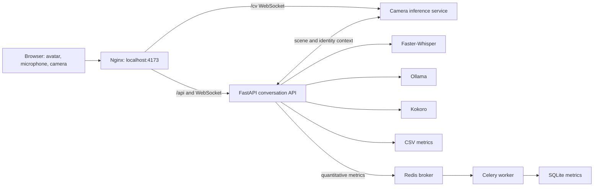
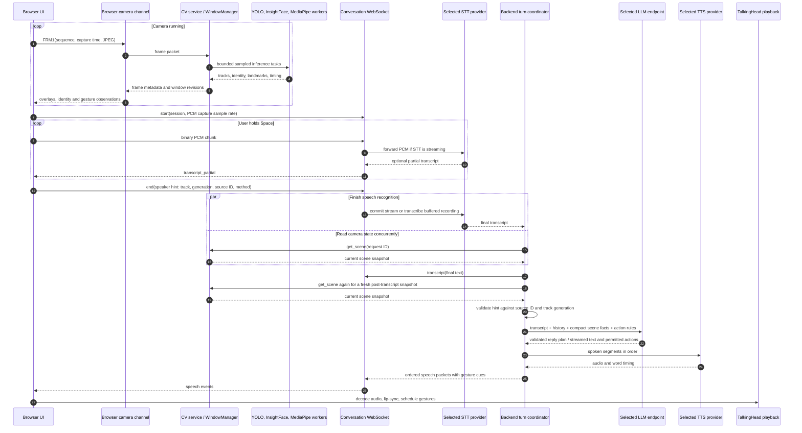

# Virtual Human

Virtual Human is a browser-based 3D companion with push-to-talk conversation,
speech playback, lip synchronization, expressive gestures, and optional camera
understanding. The Docker demo uses local Ollama, Faster-Whisper, and Kokoro.
Celery and Redis handle background metrics. **No sign-in is required; Keycloak
and the authentication gateway have been removed.**

## Start the Docker demo

Use Docker Desktop with Linux containers and Compose 2.24 or newer. Initial
setup needs an internet connection to download images and model weights.
Run all commands below from the repository root.

### NVIDIA GPU

The root Compose entry includes `devops/compose.gpu.yaml` for NVIDIA
acceleration in Ollama and Kokoro. Use this command on a machine with a
supported NVIDIA GPU and Docker GPU access:

```powershell
docker compose up --build -d
```

### CPU only

Specify only the base file to bypass the GPU override:

```powershell
docker compose -f devops/compose.yaml up --build -d
```

For CPU-only operation, keep `-f devops/compose.yaml` in subsequent Compose
commands, including logs, rebuilds, and shutdown. CPU inference can be slower.

Open **http://localhost:4173** once startup completes. Allow microphone access
to speak and camera access to use visual context. Hold Space to record, then
release it to submit your turn. The response audio plays automatically.

The `ollama-init` and `speech-init` services download the required chat and
speech recognition models before the API starts. An initializer that finishes
with exit code 0 is normal. Check progress with:

```powershell
docker compose ps -a
docker compose logs -f ollama-init speech-init backend cv worker
```

For the default GPU setup, Windows users can also run:

```powershell
.\devops\Start-VirtualHuman.ps1
.\devops\Start-VirtualHuman.ps1 -Rebuild
.\devops\Start-VirtualHuman.ps1 -Stop
```

Stop the stack with `docker compose down`. Named volumes are retained.
`docker compose down -v` deletes volumes, including model caches and stored
data; do not use it for a routine restart.

See [Docker setup](docs/docker.md) for more operational details and
[the changelog](CHANGELOG.md) for changes credited to **Bhvan Madhusudhan**.

## Services and connections



| Service | Purpose | Docker access |
|---|---|---|
| `talking-avatar` | Nginx, static UI, API and camera proxies | `127.0.0.1:4173` on the host |
| `backend` | Conversation sessions, STT, LLM and TTS coordination | Internal port 8000; browser uses `/api` |
| `cv` | YOLO, InsightFace and MediaPipe inference | Internal port 8765; browser uses `/cv` |
| `ollama` | Local `qwen3.5:2b` chat model | Internal port 11434 |
| `kokoro` | Local speech synthesis and word timing | Internal port 8880 |
| `redis` | Celery broker and task results | Internal port 6379 |
| `worker` | Save quantitative metrics to SQLite | No HTTP interface |
| `ollama-init`, `speech-init` | Prepare models before API startup | One-time startup jobs |

Only the frontend publishes a host port. API and camera connections use the
same browser origin, including through an HTTPS tunnel. Camera preview runs
in the browser; a visible preview alone does not confirm that CV inference is
connected. In Compose, the CV service starts with the rest of the stack.

## Configuration

| Run mode | Configuration | Apply changes |
|---|---|---|
| Docker | `backend/config.docker.yaml`, copied into the image as `config.yaml` | Rebuild and recreate the affected services |
| Host development | `backend/config.yaml` | Restart the backend and, for camera settings, the CV process |
| Frontend Docker build | Build arguments in `devops/compose.yaml` | Rebuild `talking-avatar` |

Docker configuration is baked into the image. Editing `backend/config.yaml`
on the host does not change a running Docker backend. After Docker settings
change, run `docker compose up --build -d`. If you change `llm_model`, also
change the model name in the `ollama-init` command in `devops/compose.yaml`;
the initializer does not read the YAML model setting automatically.

The Docker defaults are:

- Chat: Ollama `qwen3.5:2b`, structured JSON plans, and disabled thinking output.
- Speech recognition: Faster-Whisper `base`, CPU, `int8`.
- Speech synthesis: Kokoro, using CPU or the NVIDIA override.
- Speech segments: 8-word minimum, 12-word maximum, one synthesis request at a time.
- Camera inference: a separate CPU service with persistent model caches.
- OpenObserve diagnostics: disabled in Compose.

`backend/.env` is optional for Docker. Use it for provider credentials when
selecting hosted services; keep it out of version control. Docker service
names such as `ollama`, `kokoro`, and `cv` resolve inside the Compose network.
Host processes must use reachable host addresses instead.

### Speech speed and timing

Users can ask the avatar to speak slowly or faster. The model can emit inline
tags such as `[speed:0.85]`, `[speed:1.2]`, and `[speed:1.0]`. The existing tag
parser removes these tags before display and synthesis. It rejects invalid
values and clips finite values to the configured limits:

```yaml
tts_speed: 1.0
tts_speed_min: 0.75
tts_speed_max: 1.5
min_speech_segment_words: 8
max_speech_segment_words: 12
tts_max_concurrent_segments: 1
```

Keep the speed limits within the provider range of 0.25 to 4.0. A tag applies
to subsequent phrases. Persistence across turns depends on the model repeating
the preference from conversation history.

The Activity panel and metrics separate transcription, reply generation, and
speech timing. First model loads take longer than warm requests. Short segments
can reduce the wait for speech, but actual delay also depends on hardware,
model size, provider timing, and gesture pacing. See
[audio and gesture synchronization](docs/audio-gesture-synchronization.md).

## Celery, Redis, and stored data

Live speech uses the direct conversation pipeline. After a turn, the API writes
CSV metrics and queues a quantitative summary. Celery stores that summary in
SQLite. Event IDs prevent duplicate rows after task redelivery.

Redis database 0 holds the broker queue; database 1 holds task results. Redis
uses append-only persistence, and task results expire after one hour. Broker
and result-store failures use short timeouts so an outage does not hold up turn
completion. A failed queue submission is logged; the CSV remains the fallback.

Queued metrics exclude transcripts and camera payloads. **CSV metrics include
spoken response segments** in `response_segments_json` as well as timing data.

| Named volume | Stored data |
|---|---|
| `backend-data` | `/app/data/metrics.csv` and `/app/data/metrics.sqlite3` |
| `redis-data` | Redis queue and result persistence |
| `ollama-models` | Ollama model weights |
| `whisper-models` | Faster-Whisper cache |
| `cv-models`, `yolo-models` | Camera model caches |
| `cv-data` | Camera identity database and related data |

Check background services with:

```powershell
docker compose exec redis redis-cli ping
docker compose exec worker celery -A background.celery_app inspect ping
docker compose logs --tail 50 worker
```

## Host development

Use Docker for the ready-to-run local demo. Host development additionally
requires Python 3.13 or newer, `uv`, Node.js 22.12 or newer, npm, and any native
libraries required by the model packages.

The checked-in host configuration differs from Docker: it selects OpenRouter
for chat, Nemotron at `127.0.0.1:18080` for STT, and Kokoro at
`localhost:8880` for TTS. Configure those services and credentials, or change
`backend/config.yaml` to your local providers before starting the API.

For local inference, select `stt_provider: faster-whisper`, an accessible
Ollama URL and model, and either a running Kokoro service or
`tts_provider: supertonic`. Prepare local models from the repository root:

```powershell
.\backend\setup.ps1
```

On Linux, use `bash backend/setup.sh`. These scripts request confirmation for
missing dependencies and model downloads. They do not start external Ollama,
Kokoro, or Nemotron services. Compose services are internal-only by default;
a host backend cannot reach them through `localhost` without separate port
configuration.

Start the backend from its directory:

```powershell
cd backend
uv sync --extra dev
uv run python main.py
```

Start CV in a separate terminal from the repository root:

```powershell
uv run --project backend python -m backend.cv
```

Start the frontend in another terminal:

```powershell
cd frontend
npm ci
npm run dev
```

Open http://localhost:5173. Vite proxies `/api` to the host backend on port
8000 and `/cv` to the CV service on port 8765. `npm run build` creates the
frontend bundle. Docker serves its bundle with Nginx on port 4173.

Celery is disabled by default outside Compose. A host deployment must provide
Redis and set `CELERY_ENABLED`, `CELERY_BROKER_URL`, and
`CELERY_RESULT_BACKEND` for the API, plus matching worker settings. Host CSV
metrics normally use `backend/metrics.csv`; Docker uses the named volume above.

## How a conversation flows

1. The browser opens `/api/ws` through the app proxy, captures mono PCM at
   the AudioContext sample rate (usually 16 kHz), and sends
   chunks while Space is held.
2. On release, the backend finalizes transcription. Streaming-capable STT can
   send partial transcript updates while capture is active; final text is sent
   as a separate event.
3. The backend obtains the latest camera/speaker context when CV is available,
   then calls the configured LLM with conversation history and validated action
   instructions.
4. The backend removes recognized inline gesture tags, accumulates spoken text
   at natural boundaries, and queues TTS segments. It prefers a complete
   sentence after `min_speech_segment_words`; it forces a split at
   `max_speech_segment_words` when needed. Docker uses 8 and 12 words; host development uses
   the values in `backend/config.yaml`.
5. In `native` LLM mode, text can reach TTS while later text
   is still being generated. Docker uses `structured` mode, which validates
   a JSON plan before speech generation. Each Kokoro segment waits for its matching audio
   and provider timestamps before delivery.
   Audio requests are sent in segment and chunk order. Each segment queue is
   bounded so a slow client cannot accumulate unlimited audio in memory.
6. The browser decodes each audio packet independently and passes audio and
   word timing to TalkingHead. TalkingHead produces visemes for lip sync; the
   browser schedules gesture cues against the audio timeline.
7. The backend records one turn summary and returns `done`. The frontend
   Activity panel reports transcript, reply, and first-audio milestones.

### Gesture and speech alignment

See [Audio and gesture synchronization](docs/audio-gesture-synchronization.md)
for the complete implementation flow, timing formulas, Mermaid diagrams, and
configuration reference.

The prompt allows a limited set of inline tags such as `[greeting]`,
`[thinking]`, and `[nod_yes]`. `backend/inline_gestures.py` parses these tags
incrementally, removes them from spoken/displayed text, and attaches each cue
to its following speech offset. The backend aligns cue offsets against the
word timings returned by the active TTS adapter. If the word sequence does not
match, it suppresses misaligned cues rather than triggering the wrong action.

Kokoro supplies provider word intervals. Each tag starts a speech block that
continues until the next tag. The frontend preloads clips and plays each for
at least `gesture_min_duration_seconds` (default 2), or its natural clip duration
if longer. Speech keeps its original speed. When a block's speech finishes
first, silence delays the next tagged phrase until the previous gesture finishes.
Word and gesture timestamps shift with that silence, including across streamed
packets. Longer speech blocks finish before the next gesture starts. The last
gesture can finish after its audio ends.

The Web Audio clock drives the mixer, with 100 ms transitions between gestures.
Stop clears active gestures and pending pacing. Frame scheduling and provider
alignment accuracy still limit synchronization precision.

Set these values in the active configuration file. Rebuild the backend image
for Docker, or restart the backend for host development, then reload the browser:

```yaml
gesture_min_duration_seconds: 2.0
tts_volume_gain: 1.5
```

`tts_volume_gain` controls browser speech amplitude: 1.0 preserves the original
volume, 1.5 boosts it, and 0 mutes it. Playback settings arrive through `/health`
and each speech packet. Volume gain does not change speech speed or timestamps.

The front end gives explicit speech gestures priority over lower-priority
camera responses and automatic talking motion. Name changes use a validated
`rename_person` tool and are not inferred from arbitrary model output.

## Processes, threads, and model ownership

### Visual history sent to the LLM

Every model turn receives a new world snapshot. Tool follow-up requests also
refresh that snapshot. Current scene counts stay separate from historical
observations, including when the current camera frame expires.

```yaml
cv_window_seconds: 1.0
cv_retained_windows: 30
cv_world_history_seconds: 10.0
cv_world_history_windows: 0
```

Increase `cv_world_history_seconds` to cover your speaking time and local model
latency. For example, set it to `20.0` to retain the preceding twenty seconds
of people, objects, recognized names, and gestures in model context. Alternatively,
set `cv_world_history_windows: 10` to use the current window and nine preceding
windows; a positive window count overrides seconds. Set both history values
to zero to disable it. Increase `cv_retained_windows` when needed: seconds mode
requires at least one extra window beyond the lookback. Restart both the CV
service and conversation backend after changing these settings.

Windows currently last one second. The manager publishes a summary when the
capture clock crosses the boundary, then revises it as late inference finishes.
History includes open windows and their latest results. Counts are unique
tracks per window, not totals to add across windows. Gesture ages refer to
capture time. Results still processing cannot appear until they finish.

`cv_keypoint_history_seconds` controls the gesture model's temporal input. It
does not set the LLM visual lookback.

### Runtime ownership

The application separates **coordination** from **inference**. A process is an
operating-system address space with its own memory. A thread is an execution
lane inside one process; it shares that process's memory with other threads.
The API's async event loop handles sockets, queues, and turn state. CPU-bound
model calls run on worker threads or in dedicated child processes so one slow
inference does not stop the loop from servicing WebSockets.


### In-process local model workers

Faster-Whisper and Supertonic are constructed by the API process when selected.
They are **not** separate child processes. The implementation is in
[`backend/runtime.py`](backend/runtime.py) and the provider adapters are in
[`backend/stt/faster_whisper.py`](backend/stt/faster_whisper.py) and
[`backend/tts/supertonic.py`](backend/tts/supertonic.py). Each provider owns a
`ModelWorker`—a `ThreadPoolExecutor(max_workers=1)`—and loads its model in that
worker thread. Calls from the API event loop use `run_in_executor`, await the
result, and return to the loop while the model is running. The single worker
reuses loaded weights and serializes calls to that model instance.

- Faster-Whisper loads a CTranslate2 model once during provider initialization.
  On release, it decodes the recording and transcribes in the STT worker. Its
  `cpu_threads` and `num_workers=1` settings bound the inference library's
  internal CPU work. This path is local but **not partial-text streaming**:
  transcription starts after the complete recording arrives.
- Supertonic loads ONNX sessions and voice styles once in a TTS worker. Each
  segment is synthesized there and returned to the API as audio. ONNX Runtime
  intra-op and inter-op threads are configured separately from the executor's
  one-worker setting.
- `model_workers` controls CPU affinity and model-library thread budgets.
  `cpus: auto` inspects the CPUs visible to the process and, when CPU frequency
  data distinguishes hybrid-core types, prefers the lower-frequency cores.
  `threads` limits a library's internal threads; it does not create that many
  Python executor workers.

The backend's orchestration loop stays asynchronous, but this does not make the
inference itself cheaper. A single-threaded worker can still occupy a core at
100%; it only prevents that work from blocking the API event loop. CPU
contention, model size, accelerator availability, and library thread counts
still determine response time.

### Separate services and hosted endpoints

The local Ollama model runs inside the Ollama service process/container. The
backend sends it ordinary HTTP requests using the OpenAI-compatible Chat
Completions protocol; the model does not execute inside the API's Python
process. The same client can target a hosted endpoint by changing the base URL,
model, and API key.

Kokoro follows the same service boundary. The backend asynchronously requests
`/dev/captioned_speech` and consumes WAV audio with word timestamps. With the Compose Kokoro service, the
model runs in its own container, using CPU in the base configuration or GPU
with the NVIDIA override. With a hosted speech endpoint, inference
runs remotely. In either case, the backend owns request ordering, queueing,
conversion to independently playable packets, gesture timing, and delivery to
the browser. Kokoro uses an async request semaphore, so up to
`tts_max_concurrent_segments` requests may be in flight. Supertonic has the
same configured segment scheduling limit, but actual calls to its one-thread
`ModelWorker` run serially against the loaded model.

### CV child processes and RPC

The CV application is a separate service process. It owns the camera WebSocket,
capture windows, latest scene state, and three persistent `ProviderProcess`
children: YOLO object detection, InsightFace recognition, and MediaPipe
landmarks. These children are started with Python's `spawn` multiprocessing
context and load their model libraries and weights independently of the API
and of one another.

The CV parent talks to each child over a local `multiprocessing.Pipe`. A call
contains a method name, arguments, and trace context; the child runs that
provider method and sends either a result or a serialized error back. A lock
keeps each provider's pipe request/response pair in order. Frame arrays are
serialized through the pipe when a provider needs the image, so each RPC has
copy and serialization cost in addition to model time. Sampling and the busy
stage flags bound this work instead of building a queue of old images. The
parent waits for RPC using `asyncio.to_thread`, so a blocking pipe read does
not freeze the CV event loop. Inside the child, each provider uses its own one-thread
`ModelWorker` for model calls. Thus, for example, MediaPipe has a CV child
process, a model worker thread inside that process, and the model library's
configured inference threads inside that worker.

Object, face, and landmark inference therefore have separate process memory
and failure boundaries. They can run independently of conversation STT and
TTS. Calls to one specific provider are serialized by that provider's RPC
channel and model worker. Face work can be scheduled for several tracks, but
`cv_max_face_tasks` bounds pending face jobs; it does not create additional
InsightFace model instances.

## CV capture windows and inference pipeline

The CV service processes camera frames independently of speech recognition.
It does not receive the microphone PCM stream. The browser opens a second
WebSocket, normally `ws://localhost:8765`, and submits JPEG frames using the
`FRM1` binary envelope:

| Field | Size | Meaning |
|---|---:|---|
| Magic | 4 bytes | ASCII `FRM1` identifies a camera packet |
| Sequence | 4 bytes | Increasing unsigned frame number |
| Capture timestamp | 8 bytes | Browser capture time as a big-endian float64 in milliseconds |
| JPEG length | 4 bytes | Number of following image bytes |
| Image | Variable | JPEG payload |

Only one WebSocket may own the camera feed at a time. The service validates
packet size, decodes JPEG off the event loop, rejects invalid/oversized images,
and associates each accepted frame with its sequence number and capture-time
timestamp. A new camera owner resets transient trackers and starts a new source
ID so results from an old camera session cannot be mistaken for current data.

### What a window means

`WindowManager` maps capture timestamps into fixed-duration buckets. The checked
in `cv_window_seconds` is one second, so frames captured from 10.0 through
10.999 seconds belong to the same window. It does not wait for a window to
finish before processing frames. Instead, it schedules eligible model stages
as tasks and records each result back against the originating frame and
window.

The source clock matters: inference may take longer than one window, but the
frame still belongs to the interval when it was captured. A 20 ms heartbeat
advances the capture-time watermark even when no frame arrives. Advancing the
watermark closes elapsed windows, expires old retained data, trims landmark
history, and publishes completed summaries. Defaults retain 30 windows and a
shorter three-second landmark history.

### Sampling, dependencies, and backpressure

Each incoming frame is recorded, but expensive stages are sampled separately:

1. **Object detection and tracking** run at up to `cv_object_fps` (20 FPS in
   the checked-in configuration). Ultralytics uses persistent tracking IDs so
   detections can be associated across frames.
2. **Landmark and gesture inference** runs at up to `cv_keypoint_fps` (30 FPS).
   When object detection is scheduled on the same frame, the keypoint task waits
   for those tracks and analyzes person crops. Otherwise it uses the latest
   completed object tracks. It uses recent landmark history to classify
   movement such as waves and mouth motion.
3. **Face recognition** is scheduled from detected person tracks, not for every
   raw camera frame. Unknown or low-quality faces can be retried after
   `cv_face_retry_seconds` (one second by default). The configured
   `cv_max_face_tasks` caps simultaneous pending face jobs. A track that leaves
   and re-enters can be reset after the configured re-entry interval.

For object and keypoint stages, the manager marks a stage busy while a sample
is running. If another frame arrives before that stage is free, it skips that
stage for the new frame instead of adding an unbounded inference queue. This is
intentional: current camera state is more valuable than processing a backlog of
stale frames. Face tasks have their own per-track and global limits.

Every frame result records which stages completed, errors, dimensions, and
per-stage elapsed time. A one-second `WindowSummary` aggregates the most recent
object/identity per track, gestures seen in the window, mouth measurements,
pending task count, errors, and average timing for each stage. A window can be
published more than once: closing publishes a revision, and a slow face result
can later produce a newer revision for that same window.

The manager stores only the latest undelivered revision per window and latest
frame update per frame. The CV service's outbound metadata queue holds at most
two batches; when full, the oldest batch is dropped. This keeps overlays and
scene context fresh when inference or a WebSocket client falls behind. It does
not cancel a model call that is already running.

Implementation entry points for this lifecycle are [`backend/cv/main.py`](backend/cv/main.py)
for process startup, WebSocket ownership, decoding and publication;
[`backend/cv/window_manager.py`](backend/cv/window_manager.py) for timestamps,
sampling, task limits and window revisions; [`backend/provider_process.py`](backend/provider_process.py)
for child-process RPC; and [`backend/runtime.py`](backend/runtime.py) for the
worker-thread and CPU-affinity policy.

### Scene snapshots are not model input images

The CV service sends frame metadata and window summaries back to the browser
for overlays and camera-driven reactions. Separately, the conversation API
queries `get_scene` over the backend-to-CV WebSocket. The scene query returns
compact facts: visible person tracks and names, objects, action and mouth
observations, window summaries, source ID, and capture freshness. The current
scene is considered fresh only when the newest object result is at most one
second old; keypoint measurements are associated when their timestamp is
within 300 ms of that object frame.

The LLM receives these compact scene facts as text/JSON context, not a camera
image. The raw JPEG is used only by local CV inference and browser preview. If
the CV service is offline, the API continues the speech turn with an
unavailable/empty scene rather than failing STT or TTS.

## How CV data joins an STT → LLM → TTS turn

The camera and conversation WebSockets are separate channels. The frontend
combines their outputs only to select a speaker and animate the avatar. The
backend combines them at a defined point: after push-to-talk ends, it pairs the
final transcript with a fresh scene snapshot before constructing the LLM
request.



### Speaker evidence and snapshot timing

While the camera channel is active, the browser keeps recent CV metadata. At
push-to-talk start, `SpeakingEvents` uses that metadata to select a person when
exactly one person is visible. If there are several people, it compares
microphone RMS activity with timestamp-matched MediaPipe mouth-motion values;
it accepts a speaker only when one current track is a clear match. The snapshot
contains the track ID, generation, camera source ID, and evidence method.

At key release, the browser sends this hint with the `end` command. The backend
starts a `get_scene` query immediately, at the same time as it asks STT to
finalize the utterance. Thus camera lookup can overlap transcript finalization.
After STT returns, the API emits the final transcript event and obtains a
second, fresher scene snapshot. It validates the browser's hint locally against
that snapshot, requiring the same camera source ID and track generation. If
the second snapshot cannot identify the hinted speaker, the release-time
snapshot is a fallback. A stale or unmatched hint does not become an identity
claim. The hint itself is not sent to the CV service; the service returns the
scene, and the API performs the match. This overlaps camera I/O with STT, but
it does not make the LLM start before the final transcript and scene context
are ready.

### What STT, LLM, and TTS each receive

- **STT** receives microphone audio only. Faster-Whisper receives the complete
  recording after release. Nemotron receives PCM chunks while the user speaks
  and returns partial text for display, then a final transcript after commit.
- **LLM** receives final recognized text, bounded session history, and a compact
  textual/JSON world state. It does not receive raw camera frames or the CV
  model weights. Current speaker identity is included only when the current
  visual track corroborates the browser's speaker hint. In structured mode the
  API validates a complete plan before dispatching actions or speaking it.
- **TTS** receives only the clean spoken text segment, selected voice, and
  speech speed. CV is not queried for every audio chunk. Model-authored inline
  gesture tags are parsed by the backend, attached to the associated segment,
  and aligned to its word timing. Camera-triggered reactions follow the
  browser's separate CV event path.

The normal speech-turn path does not send the transcript to CV. Identity
renaming is a separate, validated LLM tool action: the backend sends the
requested name and current track/source identity to CV, where the service
rechecks that the target still exists before changing the identity record.
When CV is unavailable, that action fails safely and speech can continue.

The source path for the turn coordinator is [`backend/pipeline.py`](backend/pipeline.py);
the bounded CV request and speaker validation are in
[`backend/world.py`](backend/world.py). Browser capture and camera event
handling are in [`frontend/src/main.js`](frontend/src/main.js),
while microphone to speaker evidence matching is in
[`frontend/src/cv/speakingEvents.js`](frontend/src/cv/speakingEvents.js).

## Interfaces

The Docker health endpoint is http://localhost:4173/api/health. Host development
also exposes `http://localhost:8000/health`. This checks that the API responds
and reports provider settings; it does not verify successful model inference.

The browser uses `/api/ws` for conversations. A direct host API client uses
`ws://localhost:8000/ws`. Start a turn with a JSON message such as:

```json
{
  "type": "start",
  "session_id": "browser-session-id",
  "mime_type": "audio/pcm",
  "sample_rate": 16000,
  "voice": "af_heart",
  "speed": 1.0
}
```

Send the actual capture sample rate, then binary audio chunks and
`{"type":"end"}`. Cancel with `{"type":"cancel"}`. Events include `transcript`,
`llm_delta`, `llm_complete`, `speech`, `metrics`, `error`, and `done`;
partial transcripts depend on the selected STT provider. Speech packets carry
audio, timing, segment identifiers, and gesture cues.

For direct synthesis, send a `start` message with `mode: "speak"` and a `text`
value. This bypasses STT and LLM processing and uses the selected TTS provider.

## Verification

From the repository root:

```powershell
node --test frontend/tests/*.test.js
uv run --project backend --extra dev python -m pytest -c backend/pyproject.toml backend/tests -q
```

To run backend tests with Docker instead of the host environment:

```powershell
docker compose run --rm --no-deps -v "${PWD}/backend/tests:/app/backend/tests:ro" backend uv run --no-sync --with pytest --with pytest-asyncio python -m pytest tests -q
```

Validate the Compose configuration with `docker compose config --quiet`.
For CPU-only testing, include `-f devops/compose.yaml`. Tests that require
optional model assets may be skipped when those assets are unavailable.
See [CHANGELOG.md](CHANGELOG.md) for recorded checks and their limits.

For a manual smoke check, open the app, verify `/api/health`, record a short
phrase, and confirm that a reply and speech arrive. Check camera preview and
CV status separately. Redis ping and Celery worker ping should both succeed.

## Troubleshooting

| Symptom | Check or action |
|---|---|
| GPU reservation or driver error | Verify Docker GPU access, or use the CPU-only Compose command. |
| Startup appears stuck | Read `ollama-init`, `speech-init`, and model service logs. First startup downloads weights. |
| Port 4173 is in use | Stop the conflicting listener or change the frontend host port in Compose. |
| An old sign-in page appears | Open the app root at `http://localhost:4173`, rather than an old `/oauth2/callback` URL. Rebuild the current stack if needed. |
| Camera preview works but scene context is missing | Check the `cv` service logs and browser `/cv` connection. Preview and inference have separate status. |
| Microphone or camera access fails | Allow browser permissions, check other apps using the device, and use localhost or an HTTPS origin. |
| Speech takes too long | Compare transcription, LLM, and first-audio timings. Check GPU use, cold model loads, and CPU contention before changing segment settings. |
| `/think` appears in text | Confirm the Docker configuration and model are current, then rebuild. Docker uses structured plans and stop markers for thinking controls. |
| A conversation fails | Check `docker compose logs --tail 100 backend ollama kokoro` for the provider error. |
| SQLite metrics are missing | Check Redis and worker ping, then worker logs. CSV may still contain the turn if queue submission failed. |
| A config edit has no effect | Use `config.docker.yaml` and rebuild for Docker; use `config.yaml` and restart for host development. |

## Repository map

```text
virtual-human/
|-- backend/                 API, model providers, CV, and Python tests
|-- frontend/                Browser application, assets, and JavaScript tests
|-- devops/                  Compose services, Dockerfiles, Nginx, and launcher
|-- docs/                    Deployment and implementation guides
|-- TalkingHead/             Shared avatar assets and animation catalog
|-- docker-compose.yml       Root entry for the GPU demo
|-- Readme.md
`-- CHANGELOG.md
```

Deployment files use the repository root as their Docker build context.
The root Compose entry merges the base and GPU files from `devops/`.
The Compose service name `talking-avatar` stays the same; its source is now
in `frontend/`.

| Path | Purpose |
|---|---|
| `backend/main.py`, `backend/pipeline.py` | API and conversation orchestration |
| `backend/config.yaml`, `backend/config.docker.yaml` | Host and Docker settings |
| `backend/background.py` | Celery metrics tasks and SQLite persistence |
| `backend/inline_gestures.py` | Inline gesture and speed parsing |
| `backend/stt/`, `backend/tts/`, `backend/llm/` | Provider adapters and prompts |
| `backend/cv/`, `backend/runtime.py` | Vision inference and model workers |
| `frontend/src/`, `TalkingHead/` | Browser application, avatar engine, assets |
| `devops/nginx.conf` | Static serving and API/CV routing |
| `backend/tests/`, `frontend/tests/` | Regression and unit tests |
| `devops/compose.yaml`, `devops/compose.gpu.yaml` | Base CPU stack and NVIDIA override |
| [Docker setup](docs/docker.md) | Deployment and operational checks |
| [Audio and gesture synchronization](docs/audio-gesture-synchronization.md) | Playback timing and gesture implementation |
| [Changelog](CHANGELOG.md) | Local changes and validation credited to Bhvan Madhusudhan |
