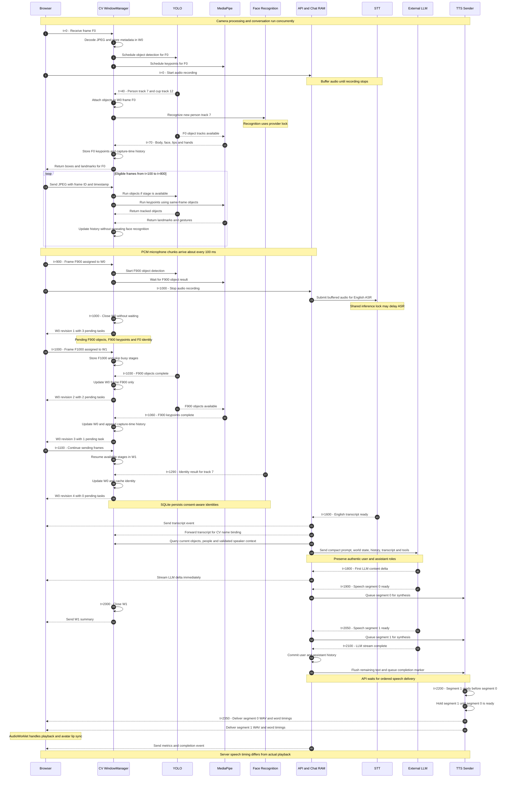
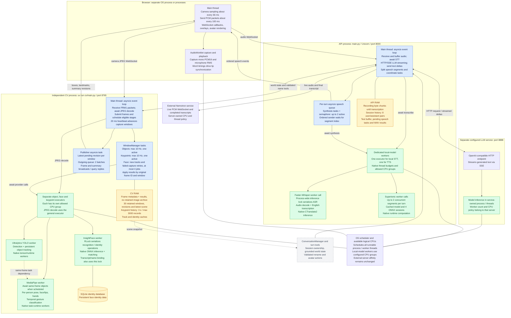

# Backend

See [OBSERVABILITY.md](OBSERVABILITY.md) for current inline gestures, per-model
process isolation, and the consolidated OpenObserve dashboard.

This directory contains the Virtual Human API. One FastAPI application handles
the WebSocket session, selected STT provider, LLM streaming,
and the selected TTS provider. Faster-Whisper and Supertonic execute inside the
backend. Kokoro and the OpenAI-compatible LLM endpoint are provider services.

## Files

- `main.py`: application startup, provider selection, and `/health` and `/ws`
  routes.
- `pipeline.py`: WebSocket protocol, conversation history, live speech
  segmentation, and session metrics.
- `config.yaml`: provider URLs, model selection, and runtime settings.
- `stt/faster_whisper.py`: local speech recognition.
- `stt/nemotron.py`: live transcription through a NeMo-Speech.cpp WebSocket.
- `tts/supertonic.py`: in-process ONNX synthesis.
- `tts/kokoro.py`: HTTP adapter for the optional Kokoro service.
- `llm/openai.py`: streaming OpenAI-compatible chat adapter.
- `Dockerfile`: Python 3.13 API image using the locked `uv` environment.
- `setup.sh` / `setup.ps1`: local development environment and model asset setup
  for Linux/macOS and Windows, respectively.

## Model setup

From this directory, run:

```bash
./setup.sh
```

On Windows, run the PowerShell equivalent from this directory:

```powershell
.\setup.ps1
```

This synchronizes dependencies, downloads the configured Faster-Whisper model
to the repository's `.cache/faster-whisper` directory, and downloads pinned
Supertonic 3 assets to `supertonic/assets`. The API uses local model files and
does not download missing models during startup. Run setup again when changing
the Faster-Whisper model.

## Run locally

Configure provider URLs in `config.yaml`, then start the API:

```bash
uv run main.py
```

When running directly on the host, use host-local addresses such as
`http://localhost:8888/v1` for a host LLM provider and `http://localhost:8880`
for Kokoro. In Compose, the default LLM URL uses `host.docker.internal`; Compose
provider service URLs use their service names (for example, `http://kokoro:8880`
or `http://ollama:11434/v1`).

## Run with Compose

From the repository root, prepare the models with `./backend/setup.sh`, then
build and start the stack:

```bash
docker compose up --build
```

The backend image installs dependencies from `pyproject.toml` and `uv.lock`.
Compose mounts the Faster-Whisper cache and Supertonic assets read-only, mounts
`config.yaml` read-only, and persists session metrics under
`backend/metrics-data/metrics.csv`.

## Nemotron speech recognition

Start the speech server yourself:

```bash
nemo-speech serve --asr-model nemotron-3.5 --open
```

Set these values in `backend/config.yaml`, then restart the conversation API:

```yaml
stt_provider: nemotron
nemotron_url: ws://127.0.0.1:8080/v1/audio/transcriptions/realtime
nemotron_model: nemotron-3.5
nemotron_language: en-US
nemotron_api_key: ""
nemotron_timeout: 120
```

`nemotron_model` labels metrics. The `nemo-speech` command selects the actual
model. Set the API key only if the speech server requires one. For a backend in
Docker, replace the loopback host with a reachable address for the host service.

The browser sends mono little-endian PCM16 packets while you hold Talk. The API
forwards each packet immediately to NeMo. Releasing Talk flushes the last packet
and commits the stream. The API collects completed transcript segments and waits
for the commit acknowledgement before it sends one full transcript to the LLM.
Partial transcripts never enter conversation history or trigger an LLM call.
Cancellation or disconnection closes the upstream stream without an LLM call.
The configured timeout bounds finalization; failed finalization reports an error.

This adapter follows the [NeMo transcription protocol](https://github.com/NVIDIA/NeMo-Speech.cpp/blob/main/docs/api.md#websocket-v1audiotranscriptionsrealtime).
Use a server build and ASR model that support this route. The API does not start
the external server or load a local Faster-Whisper model when Nemotron is selected.
To return to local transcription, set `stt_provider: faster-whisper` and restart
the API. That provider receives a WAV recording made from the same PCM packets.

## TTS device selection

Supertonic uses `tts_device: auto` by default. It selects ONNX Runtime CUDA
when available, then OpenVINO on an Intel GPU, and keeps CPU as the final
fallback (including for unsupported operators). `tts_device: cpu` forces CPU.
Automatic GPU selection still requires the matching ONNX Runtime package and
working drivers: use an ONNX Runtime build with CUDA support for NVIDIA, or
`onnxruntime-openvino` plus Intel graphics drivers for Intel GPUs. Startup logs
report the providers attached to the four model sessions. Actual speed depends
on device support and model operator coverage.

## WebSocket behavior

### Spoken text and assistant prompt

`llm/prompts/system.txt` is a compact spoken-conversation prompt. Each turn adds
fresh world data with all currently tracked objects, visible person names and
track IDs, and validated push-to-talk speaker evidence. Gesture observations are
excluded. Unavailable camera data stays unknown; it does not mean an empty room.
The model can call validated rename, gesture, and emotion tools. See
[EXECUTION.md](EXECUTION.md) for tool contracts, scheduling, and measured timings.

The review used [Liquid AI's prompting guidance](https://docs.liquid.ai/lfm/key-concepts/text-generation-and-prompting)
and [official OpenAI voice-prompting guidance](https://developers.openai.com/api/docs/guides/voice-prompting),
checked on 2026-11-01. Liquid's chat format matches the separate system, user,
and assistant roles sent by this application. The OpenAI guidance informs the
conversation style; it is not validation of LFM behavior. Prompting does not
guarantee humanlike responses. Evaluate the actual model, quantization, sampling
settings, and representative conversations when changing any of them.
Small live probes against the configured LFM2.5-1.2B BF16 model confirmed name
correction, but still showed inconsistent answers about user identity and camera
access after prompt revisions. These samples are a limitation report, not a
benchmark or a claim of reliable persona behavior. Application tests verify the
message roles and TTS processing; they cannot prove model instruction adherence.

As model text streams, the API keeps Unicode letters, marks, numbers, punctuation,
and whitespace, and replaces emoji, other Unicode symbols, and control characters
with spaces. The same sanitized text feeds displayed deltas and conversation
history. Gesture tags are parsed separately and allow surrounding whitespace.
Before synthesis, the API also removes common Markdown formatting, collapses
whitespace, and keeps Markdown link labels. Numbers are not expanded. Speech
events and lip-sync timings use this normalized text. Symbol meanings that matter
in speech should be written as words (for example, “12 dollars”). Empty segments
are skipped; direct Speak input with no words or numbers is rejected before TTS.

### Message flow

The client connects to `/ws`, sends a JSON `start` event, streams microphone
bytes, and sends an `end` event. For PCM audio, `start` includes
`mime_type: "audio/pcm"` and an integer `sample_rate` from 8000 to 96000 Hz.
Packets contain mono 16-bit little-endian samples. Existing encoded recording
clients remain supported. Faster-Whisper transcribes the complete recording;
Nemotron receives live audio and finalizes on `end`. After finalization, the API
streams each `llm_delta` as soon as it arrives, and queues speech segments for
concurrent synthesis. Speech segments split at sentence-ending periods followed
by whitespace (decimal/version periods stay within the word) or at the
configured `max_speech_segment_words` limit for long unpunctuated text. Commas do not
trigger a split. Ordered `speech` events, metrics, and `done` follow.

The low-latency configuration defaults to eight words per segment, two
configured Supertonic inference steps, and up to two concurrent segment syntheses.
The Supertonic provider honors the configured step count, with a minimum of one.
These settings can reduce first-audio latency; fewer inference steps may reduce
naturalness, and shorter segments can increase total synthesis work.

TTS responses include base64 WAV audio, sample rate, and word timing arrays for
lip synchronization. Supertonic timings are approximate. The root
[README](../Readme.md) describes the full application setup and websocket
event flow.

Kokoro uses `/dev/captioned_speech` with `stream: true` and PCM output. The API
wraps each PCM chunk in an independent WAV and sends it as soon as its turn in
the ordered speech queue arrives. Each event carries a segment `index` and a
zero-based `chunk_index`. Word and gesture times are relative to that chunk.
The HTTP connection is reused. Each segment can buffer up to two output chunks
while waiting for an earlier segment. Supertonic still returns complete segments.
Kokoro 0.8.1 accepts a complete text string per request; text-input streaming
is not enabled. See [Kokoro streaming measurements](KOKORO_STREAMING.md).

## Independent CV process

CV source is in `cv/`. It has three provider packages: `object_det`, `face_recog`,
and `keypoint_det`. Each package exposes a model-independent protocol in `base.py`.
`window_manager.py` owns capture windows and the WebSocket service. `events.py`
defines frame records, immutable summaries, and compatible identity/action events.
The conversation API does not load these models.

From the `backend` folder, install and start CV separately:

```bash
uv sync --extra dev
uv run cv/main.py
```

Run `uv run cv/main.py --check-env` to check dependencies and model assets
without starting the camera. The repository-root command
`uv run --project backend python -m backend.cv` remains supported.

Use the same global `backend/config.yaml` for both processes. The `cv` mapping
selects providers, models, confidence thresholds, tracking, and the listener.
Top-level `cv_object_fps` and `cv_keypoint_fps` control independent sampling rates;
`cv_window_seconds` defaults to one second. When inference is busy, its stage
skips samples instead of building a queue. Rates are upper limits, not guaranteed
throughput. `cv_max_face_tasks` bounds concurrent recognition work. Failed or
low-quality face captures are retried at `cv_face_retry_seconds` intervals
(default: one second). Valid unknown faces also keep retrying recognition.
Their recent embedding is retained for a validated name binding. A spoken name given before a valid capture
is saved first; a later successful capture attaches the embedding to that profile.

Select models by name in `backend/config.yaml`:

```yaml
cv:
  detection:
    model: yolov8n
  face:
    model_name: buffalo_s
  keypoints:
    pose_model: pose_landmarker_lite
    face_model: face_landmarker
    hand_model: hand_landmarker
```

Use a detection model such as `yolov8n`, `yolov8s`, or `yolo26n`. The provider
passes this name to Ultralytics, which resolves/downloads weights. Pose,
segmentation, classification, and oriented-box models are rejected here. There
is no YOLO pose model in the keypoint pipeline.

InsightFace resolves/downloads named model packs such as `buffalo_s`. The cache
is managed under `backend/assets/cv/insightface`. Identity embeddings are tagged
with the loaded recognition weights' identifier, so changing packs does not
silently mix embeddings from different recognition models.

MediaPipe Tasks requires task bundles rather than native model-name downloads.
Our registry maps the configured names to Google's versioned model downloads and
manages `backend/assets/cv/mediapipe`. Pose variants are `pose_landmarker_lite`,
`pose_landmarker_full`, and `pose_landmarker_heavy`. Body, face/lips, and hands
all use MediaPipe; InsightFace remains responsible for persistent face identity.

Run `./backend/setup.sh` from the repository root. It syncs the backend dependencies in the
backend environment, preserves STT/TTS setup, and fetches the configured CV models.
Valid cached task bundles and existing named model packs/weights are reused.
MediaPipe downloads use temporary files and atomic replacement, so interrupted
transfers are not mistaken for installed assets. Setup initializes the task models
and face pack to catch invalid assets. Download/validation failures stop setup.
Models can also be resolved at CV startup when absent; network access is required
for the first download. No model file paths need to be entered in the config.

The identity database path remains a data setting relative to the repository root.
To reuse an existing database, set `cv.identity.database_path` before startup.
Names and face embeddings survive camera reconnects and process restarts. A
profile without an embedding cannot be recognized by face. If an earlier session
saved only your name, introduce yourself once more with your face visible. Keep
the same database path and face model to use the saved embedding on later visits.
Tracker IDs are transient and are not stored in the identity tables. After an
observed absence, reentry invalidates the temporary association and matches a face
again. Camera-session and track-generation checks reject stale rename requests.
Setup does not recreate identity records.

The default shared ONNX Runtime is the backend's OpenVINO build. InsightFace uses
available CUDA, OpenVINO, or CPU execution providers. A different GPU runtime needs
an explicit environment change; installing the CV group does not add a competing
ONNX Runtime package.

The browser owns camera capture. It sends `FRM1` packets to port 8765: four magic
bytes, a big-endian uint32 frame number, a float64 timestamp in milliseconds, a
uint32 JPEG length, and JPEG bytes. The server converts timestamps to seconds.
One connection may supply frames; other connections may query results. Reconnecting
with a new camera connection resets transient trackers and source-clock windows.

The manager stores frame metadata and inference results in memory. It does not
retain frame images after the work using them finishes. Windows use half-open
capture-time intervals `[start, end)`. A timer advances windows even when capture
pauses. Model completion does not determine the window. Late results revise their
original retained window; results for expired windows are discarded.

A `window_summary` event contains a `summary` with `window_id`, `start`, `end`,
`revision`, `unique_objects`, per-label `object_counts`, `people` with track IDs
and gestures, `pending_tasks`, and `errors`. Replace an earlier summary with the
higher revision for the same window. Two tracked cups count as two objects.
Keypoint history survives window boundaries and is bounded by duration and sample
count. Windows are bounded by `cv_retained_windows` (default 30).

`frame` messages carry boxes and frame-local results for browser overlays.
`keypoints` messages carry independently sampled geometry with the original frame
number and timestamp. Schemas include `mediapipe_pose33`, `mediapipe_face478`,
`mediapipe_lips`, and `mediapipe_left_hand21` / `mediapipe_right_hand21`.
Landmarks are transformed from person-crop coordinates into full-frame pixel x/y.
Z is relative depth scaled to full-image width; pose, face, and hands retain their
own model depth origins. Body points also include visibility. Extracted lip points
include their FaceMesh vertex IDs in `landmark_indices`.

Lip records and person/window summaries include `mouth_openness` (inner lip
distance divided by mouth width) and `mouth_motion` (recent openness variance).
One Space hold produces one speaking start/end pair. Pauses, silent lips,
missing landmarks, and temporary camera absence do not split that utterance.
A single visible person is a tentative speaker association. With several people,
correlated microphone energy and lip motion can select a candidate; ambiguity
stays unknown. The API validates the hint against the CV camera session and track
generation. It retains the release-time speaker while STT finalizes, then queries
fresh visible objects and people before calling the LLM.

The frontend shows temporary perception overlays for 2.5 seconds. Camera details
and landmark drawing are available in a collapsed disclosure. The avatar is the
central stage, with a smaller camera at upper right. The STT badge comes from the
API health response and actual turn metrics.

Only `wave`, `thumbs_up`, and `open_palm` are emitted. Confirmation uses the same
person track and the same hand's capture-time history across windows. Defaults
require at least 1.2 seconds of consistent hand shape, at least four observations,
and no gap longer than 0.5 seconds. Thumbs-up requires curled fingers and an
upright thumb. Open-palm requires extended fingers and a steady hand; it represents
a stop sign. A wave requires lateral motion with at least two substantial
reversals spanning at least half the confirmation duration, rather than jitter or a single sweep.
Finger-tip motion includes waves that pivot around a stationary wrist. Hand
motion is measured relative to the person box to reduce body-translation
false triggers. Missing/inconsistent evidence breaks the confirmation span.

Tune `cv.gestures` against real camera samples. Increasing confirmation duration
requires increasing `cv_keypoint_history_seconds` as well. The history sample cap
must cover the configured duration for all visible people. If actual inference
is slower than the configured maximum gap permits, gestures deliberately remain
unconfirmed. There is no geometric body-only gesture fallback. The frontend mirrors
only these confirmed gestures and releases the pose when metadata expires.
A temporary frontend overlay displays each new gesture with the associated person's
name, such as `Alex: waving`. Repeated render frames do not repeat the event.

The configured 1.2 seconds is a minimum evidence span, not an end-to-end response
time. Four valid observations must also be available. A missing hand shape or a
gap above `cv.gestures.max_gap_seconds` restarts confirmation. Model execution and frame delivery
add latency. The configured 10 Hz keypoint rate is a maximum; busy inference skips
samples. A reported five-second response can result from these effects, but its
cause needs capture and inference measurements to confirm.

`cv.keypoints.crop_padding` is a fraction of box dimensions on each side. A value
of 0.2 adds 20% of width to both left and right edges, and 20% of height to both
top and bottom edges. A value of 0.3 adds 30% on each side. The crop is clipped
at image boundaries. With 0.3, a 200 by 400 pixel box becomes up to 320 by 640 pixels. This
margin helps keep raised hands in the crop; it does not change gesture timing.

Queries use JSON messages:

```json
{"type": "get_scene", "request_id": "turn-42"}
```

The reply echoes the request ID and contains `type: "scene"` and `data`.
`get_windows` returns retained closed-window summaries. `get_people`,
`detect_objects` (cached objects), and `transcript` are also supported. Consumers
must match response types and request IDs because broadcasts share the socket.
Each conversation turn queries CV and supplies compact world state to the LLM.
The API uses model tools for name changes instead of competing background
transcript renaming. The CV transcript endpoint remains available for compatibility.
A visible identified person alone is not verified as the acoustic speaker.

Tracking follows the [Ultralytics tracking API](https://docs.ultralytics.com/modes/track/).
Hand inference uses the [MediaPipe Tasks API](https://ai.google.dev/edge/mediapipe/solutions/vision/hand_landmarker/python).

Run tests from the repository root:

```bash
METRICS_CSV_PATH=/tmp/cv-test-metrics.csv backend/.venv/bin/python -m pytest -c backend/pyproject.toml backend/tests
```

Tests under `tests/cv/` cover the migrated algorithms and the WebSocket service.
The real MediaPipe smoke test skips when the package or any task asset is absent. Live camera and
model accuracy still require manual checks with the installed providers.

The old `scratch/measure_baseline.py`, `scratch/measure_optimized.py`, and CV
benchmark are consolidated into one benchmark:

```bash
uv run --project backend python -m backend.scripts.benchmark_cv --frames 50 --label current
```

Add `--video path.mp4` for recorded input. The benchmark reports initialization,
serial processed-frame latency, throughput, CPU peak RSS, GPU allocation, and
provider errors as JSON. Compare outputs from different revisions; no fixed
historical RAM measurement is built into the calculation. It measures model work,
not live network or browser latency.

### Landmark preview diagnostics

The browser draws body joints/bones, face points, lip contours, and hand landmarks
on the local preview. Point frames have independent sequence ordering from object
boxes, so slower landmark inference is retained when newer object boxes arrive.
Geometry is mirrored and scaled from source pixels; old point frames expire after
1.5 seconds of capture age. Low-visibility body points are hidden. The landmark
badge shows returned point counts, waiting, stale, no detections, or unavailable.

The MediaPipe `NORM_RECT without IMAGE_DIMENSIONS` message is a projection warning.
It alone does not establish that inference stopped: during investigation the live
service returned 33 pose, 478 face, and 40 lip points after that warning, without
an inference error. See the [MediaPipe projection calculator](https://github.com/google-ai-edge/mediapipe/blob/master/mediapipe/calculators/util/landmark_projection_calculator.cc).
Use the badge and returned metadata to check actual detection state. Point results
are distinct from gesture confirmation; the two-second gesture rule still applies.

Overlay regression tests run without a camera or browser:
`node talking-avatar/tests/landmarkOverlay.test.js` from the repository root.

## Execution timeline: camera and conversation together

Read the sequence from top to bottom. All times below are **illustrative**, not
benchmark results. They use milliseconds relative to an aligned capture-window
boundary. Actual windows use the browser's timestamp in seconds and
`floor(timestamp / cv_window_seconds)`; window IDs need not start at zero.
`F0`, `F900`, and `F1000` are example frame IDs labelled by capture time, not
literal production sequence numbers. Network/decode overhead is omitted here.

This example uses 10 Hz object/keypoint sampling, one person (track 7), and one
cup (track 12). W0 covers `[0, 1000)` and W1 covers `[1000, 2000)`.
It uses Faster-Whisper. With Nemotron, audio streams to the external speech
server during recording; release commits it before the final transcript reaches
the LLM.
Most object calls take 40 ms and keypoint calls 30 ms. One object call takes
130 ms; the first face call takes 1250 ms. The speech recording ends at 1000 ms.



The revision numbers illustrate isolated completions. The 20 ms heartbeat
collects updates, coalesces revisions per window, and places batches in a bounded
two-batch outgoing queue. Slow clients may miss intermediate revisions or older
batches. Consumers should replace a window by a higher revision, and use
`get_windows` to resynchronize retained summaries; broadcasts are not a durable
or guaranteed-delivery event log.

A summary counts distinct track IDs: the person and cup above count as two
objects. It includes window start/end, revision, counts by label, people and track
IDs, identity/gesture/mouth measurements where available, pending work, and
errors. Early summaries are provisional. An expired window's late results are
discarded. The first face result revises F0's window; identity caching does not
retroactively rewrite every earlier frame.

Gestures use capture-time observations across windows. For example, an open palm
observed consistently from t=200 to t=2200 can only be confirmed after sufficient
samples span two seconds with no excessive gaps. This illustrative conservative example uses two seconds. The active configuration
uses 1.2 seconds, four observations and gaps no longer than 0.5 seconds. Waves additionally
need repeated substantial reversals. A single frame, window, or late result is
not sufficient by itself. Space holds define speaking sessions; lip motion and microphone activity help
associate their speaker. The CV service does not classify speech
from lip motion alone or set an active speaker for backend policy.

### What latency changes

Model completion time never changes a frame's ID, capture timestamp, or owning
window. The timer does not await inference. A slow face call therefore does not
hold up object sampling, and CV does not await a conversation response. The API
can stream text while synthesizing earlier speech segments.

Latency still delays detections, identity labels, and audible replies. Busy CV
stages skip samples rather than accumulating an inference backlog; slow inference
can prevent gesture confirmation. Keypoints await same-frame objects when both
were scheduled; otherwise they use the latest available tracked objects. More
visible people increase crop inference work. TTS preserves segment order even if
later segments finish first, so an early slow segment delays later audio. CPU
contention, JPEG decode, network delays, and event-loop work can delay heartbeat
execution. This is asynchronous coordination, not a hard real-time guarantee.

## CPU execution: processes, event loops, and worker threads

This map includes local Faster-Whisper as an alternative to the configured external
Nemotron service, plus local Supertonic and standalone CV. Boxes are logical responsibilities, not dedicated cores or a fixed number
of OS threads. The optional HTTP Kokoro path replaces local Supertonic work with
another service call. Nemotron replaces the local Faster-Whisper worker with
asynchronous WebSocket I/O to its external process; it does not use the API's
STT inference lock or load a local ASR model.



An `asyncio` task is a coroutine on its process's event-loop thread, not a new
CPU thread. Awaiting network I/O or an offloaded worker lets that loop run other
tasks. Model providers use dedicated single-thread executors. ONNX sessions and
PyTorch also receive native thread limits; MediaPipe controls its native pool size
inside the worker CPU affinity. JPEG decode uses the general executor. The API
and CV have independent loops and pools, but compete for the same machine's CPU
and memory.

Native libraries can create additional threads and execute computation outside
the Python GIL. A single Python inference call can therefore consume several
logical CPUs. This does not guarantee parallel speedup: native thread pools,
provider locks, device selection, and CPU contention determine actual behavior.
The two-TTS limit is **per turn**, not a process-wide limit across all clients.
The face limit bounds scheduled jobs; its lock still allows only one protected
identity operation at a time. Faster-Whisper likewise serializes inference
through its shared lock. Local model initialization occurs before normal serving
work. The manually started Nemotron service owns its own model lifecycle.

### Stored data and lifetime

| Owner | Stored data | Lifetime and limits |
| --- | --- | --- |
| Browser | Local camera preview, overlays, microphone activity, lip history, perception events, queued speech | Overlays expire after 1.5 s; microphone history is bounded to 4 s and cleared on release; utterance attribution lasts for one Space hold; event overlays expire after 2.5 s; playback audio remains queued until played |
| Browser session storage | Conversation session ID | Survives reload in that tab; does not preserve server RAM after an API restart |
| API | Recording bytes for nonstreaming STT, final transcript segments for Nemotron, session history, speech buffers, pending TTS results | Audio is limited by `max_audio_bytes`; Nemotron PCM is forwarded without retaining the recording; history is bounded per session to eight pairs; up to 128 sessions retained by recency; no durable chat history |
| CV active workers | Decoded image and per-person crops | Retained while work references them; not an image recording archive |
| CV WindowManager | Frame IDs/timestamps/dimensions, detections, identities, landmarks, completed stages/errors, window summaries | 30 capture windows by default; late results only update retained windows |
| CV temporal history | Track-associated keypoint observations and capture timestamps | Both three-second and 3000-record bounds apply; shared across windows |
| CV identity provider | Track-to-identity cache and persistent identities/embeddings | Cache is pruned with tracks; SQLite survives restart and follows consent/matching rules |
| Disk model caches | YOLO weights, InsightFace pack, MediaPipe bundles, STT/TTS assets | Reused across runs; separate from transient window data |
| Diagnostics | Real LLM payload/reply traces and execution spans when enabled; conversation metrics CSV | JSONL rotates at 5 MB with two backups per log; metrics CSV is a separate output |

The speech queue has no explicit capacity bound; short segments and slow TTS can
accumulate queued work within a response. CV's bounded queues intentionally
favor recent state. These are different backpressure policies, not equivalent
latency guarantees.

### Reading timings and CPU measurements

`stt_total_ms` covers the awaited transcription call, including worker/lock wait.
`llm_ttft_ms` ends at the first yielded content delta; `llm_total_ms` ends when
the LLM stream completes, before waiting for TTS drain. `tts_ttfb_ms` measures
from the first sent segment's synthesis start to its first playable chunk's
availability for sending (the complete segment for Supertonic). It includes
provider buffering and ordered-delivery wait, rather than raw network first-byte
time. `tts_segments` counts text requests; `tts_audio_chunks` counts sent audio
chunks and appears in WebSocket metrics. `first_speech_end_to_end_ms`
and `end_to_end_ms` start when the server handles the WebSocket, so recording and
upload time are included. Browser decode, playback queueing, and physical audio
output happen later.

To observe actual process and thread placement without generating a conversation,
run from the repository root while the services are running:

```bash
uv run --project backend python -m backend.scripts.monitor_resources --seconds 30 --interval 1
```

The monitor discovers listener processes for API, CV, and the configured local
LLM, then samples their descendants and exports to OpenObserve. It writes no
local measurement files. File output through `--output` is disabled.
Use `--pid role=PID` for processes listener discovery cannot identify. Missing
roles are reported; an absent discovery result is not a measurement of zero load.
Process CPU percentages use 100% for one logical CPU and can exceed 100%.
Thread records include native thread IDs, CPU-time deltas, and last observed
logical CPUs; topology maps logical CPUs to physical core/package IDs on Linux.
Affinity is the allowed CPU set, not evidence of where a thread executed.
Sampling shows observed placement, not every migration between samples. RSS can
include shared pages, so summing process RSS can double-count memory.

When `diagnostics_enabled` is true, OpenObserve `vh_stages` spans give module,
process/thread IDs, elapsed time, calling-thread CPU time, and sampled start/end
CPU IDs. Correlate these with resource samples to see which Python worker invoked
a model. Native runtime worker activity is not fully attributable to that calling
thread, especially when calls overlap. These CPU measurements do not measure GPU
utilization. The diagrams show scheduling rules; only measurements under a
representative workload establish resource use and actual latency.
