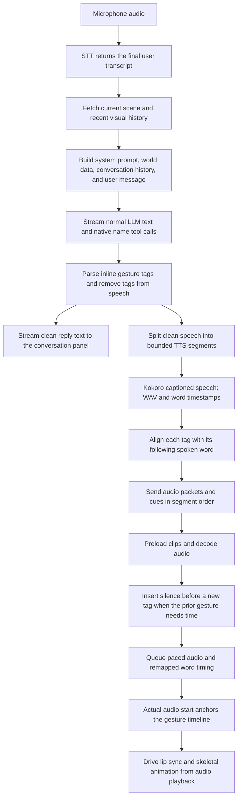
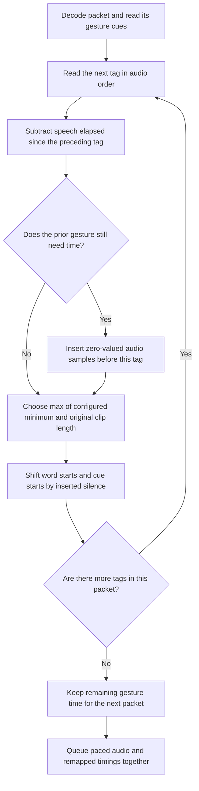
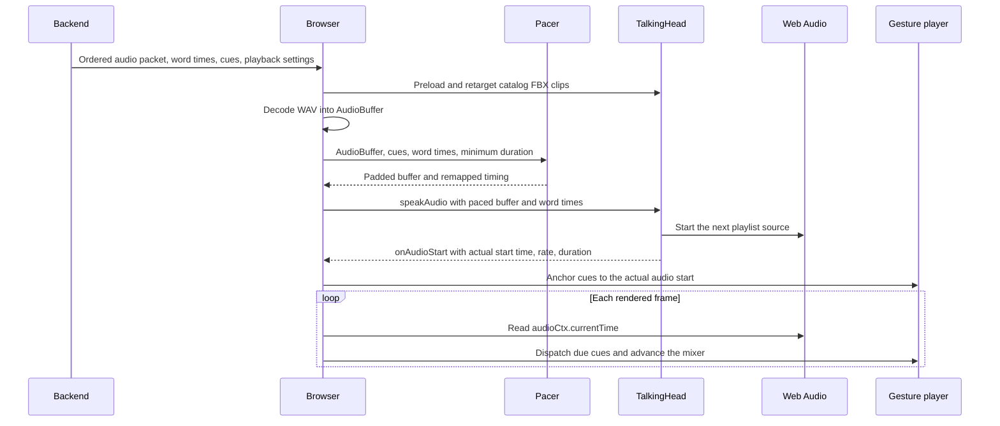
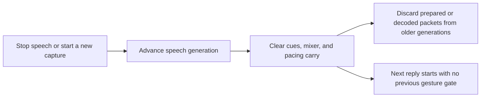

# Audio and gesture synchronization

This document describes the current implementation. It covers normal speech,
inline gesture tags, Kokoro word timing, paced playback, cancellation, and
visual context. The browser renders the avatar with TalkingHead and Three.js.

## 1. End-to-end flow



A gesture is not an LLM tool. For example, `[clapping]Well done!` produces the
spoken words `Well done!` and a separate clapping cue. `rename_person` is the
only model tool. A successful name tool can cause another model request; that
request gets a refreshed world snapshot.

## 2. Backend text and timing

### Text parsing

`InlineGestures` accepts only catalog tags. It handles tags split across LLM
stream chunks, records their clean-text offsets, and removes unsupported tags.
The display and TTS paths share normalized lexical text. Normalization removes
formatting and list prefixes rather than speaking the markup.

The backend splits speech using `min_speech_segment_words` and
`max_speech_segment_words`. These synthesis boundaries are independent of
gesture boundaries. A gesture's phrase can span several audio packets.

### Kokoro contract

The backend sends each segment to `/dev/captioned_speech` with:

```json
{
  "model": "kokoro",
  "input": "Hello. Yes.",
  "voice": "af_heart",
  "speed": 1.0,
  "response_format": "wav",
  "stream": false,
  "return_timestamps": true
}
```

The service returns base64 WAV audio and a timestamp list. Each timestamp has
`word`, `start_time`, and `end_time` in seconds. The adapter converts them to
`words`, `wtimes`, and `wdurations`; the last two arrays use milliseconds.

The adapter buffers a complete synthesis segment before delivery. It does not
use estimated word timing. Missing audio or unusable intervals fail synthesis.
A first word that starts before zero but ends in the audio is clipped to zero;
its end and all later word intervals stay unchanged. Non-finite, reversed,
wholly negative, or out-of-order intervals remain invalid. The adapter also
checks that timestamps fit the WAV duration, allowing 50 ms of end tolerance.

`StreamingCueAligner` compares normalized words with provider words. If the
sequences disagree, it suppresses misaligned gesture cues. It does not guess
which word should receive a tag. Punctuation entries do not shift the lexical
word index; the aligner preserves the original provider entry for duration.

A simplified speech packet looks like this:

```json
{
  "type": "speech",
  "index": 0,
  "chunk_index": 0,
  "audio_base64": "...WAV bytes...",
  "audio_encoding": "wav",
  "sample_rate": 24000,
  "words": ["Hello", ".", "Yes", "."],
  "wtimes": [0, 400, 500, 750],
  "wdurations": [400, 100, 250, 100],
  "gestures": [
    {"action": "greeting", "at_ms": 0, "word_index": 0, "duration_ms": 400},
    {"action": "nod_yes", "at_ms": 500, "word_index": 1, "duration_ms": 250}
  ],
  "gesture_timing_quality": "provider",
  "playback": {
    "gesture_min_duration_seconds": 2.0,
    "tts_volume_gain": 1.5
  }
}
```

The backend's cue duration is the following word's provider interval. The
browser replaces that duration with a complete gesture duration before playback.

### Request ordering

TTS requests can run concurrently up to `tts_max_concurrent_segments`. A sender
preserves segment order and packet order. Bounded per-segment queues prevent a
slow receiver from building an unlimited packet backlog. Native LLM text can
reach TTS while later response text is still being generated.

## 3. Gesture blocks and silence

A tag starts a speech block. The next tag ends that block. Speech and the
block's gesture start together. The next block waits for both the speech and
the current gesture to finish.

Let:

- `M` be `gesture_min_duration_seconds`.
- `L` be the animation clip's original duration.
- `G = max(M, L)` be the gesture's playback duration.
- `S` be the speech time between the current tag and the next tag.
- `P = max(0, G - S)` be the required silence before the next block.

The player uses `L / G` as the animation time scale. It never compresses a full
clip into a short spoken word. With a two-second minimum, a 0.8-second clip
plays at 0.4 times its original speed; a 2.4-second clip keeps its original speed.



The browser adds silence instead of suspending the audio context. Suspending
that context would also stop the clock that drives the gesture. Zero-valued
samples let the clock and animation advance while the character stays quiet.
The browser preserves the speech samples, word durations, and speech rate.
It shifts word starts and gesture starts together, so lip sync also waits.

`GestureSpeechPacer.remaining` carries the unfinished gesture duration across
packets. Untagged continuation speech reduces that duration. When a later
packet starts another tagged phrase, the pacer inserts only the silence still
needed by the planned audio sequence. Real synthesis or network gaps can make
the experienced pause longer; they do not shorten the minimum gesture interval.

The final gesture can finish after the last audio packet ends. There is no
extra spoken phrase to hold at that point. The render loop continues to advance
its animation against the audio context clock.

### Worked example

Assume both clips are shorter than two seconds and the configured minimum is
two seconds. The provider audio contains `Hello` from 0.0 to 0.5 seconds and
`Yes` from 0.5 to 0.8 seconds:

| Event | Original time | Paced playback |
| --- | --- | --- |
| Start greeting and say Hello | 0.0 s | 0.0 s |
| Hello ends | 0.5 s | 0.5 s |
| Quiet period while greeting finishes | None | 0.5–2.0 s |
| Start nod and say Yes | 0.5 s | 2.0 s |
| Yes ends | 0.8 s | 2.3 s |
| Nod finishes | None | 4.0 s |

If `Hello` takes three seconds, it already exceeds the two-second gesture
minimum. The next block starts after that three-second speech block without
an added pause. If the greeting clip itself takes 2.4 seconds, the next block
waits for 2.4 seconds instead of two.

## 4. Browser scheduling and animation



The frontend promise queue serializes preparation and decoding. TalkingHead's
speech queue and audio playlist serialize actual playback. Receiving a packet
or completing a decode does not mean that its audio has started.

`onAudioStart` supplies the scheduled start of the actual audio source. For a
cue at `at_ms`, the frontend schedules:

```text
absolute cue time = audio start + at_ms / 1000 / source playback rate
```

The pacer accounts for the source rate when inserting silence and setting cue
durations. The usual source rate is one. TTS speed is a separate provider input;
its timestamps already describe the resulting synthesized audio.

`GestureTimeline` dispatches due cues from `audioCtx.currentTime`, not from a
chain of timers. It skips expired cues rather than replaying a backlog. Late
but still active cues start partway through the clip to match elapsed audio.

`AudioGesturePlayer` uses a dedicated Three.js mixer on the avatar armature.
It shares that mixer among foreground clips. A transition blends the outgoing
and incoming actions for 100 ms. The finished action stops after its fade.
A completed final gesture fades out over 100 ms. Speech pacing normally prevents
one tag from cutting off the previous gesture; explicit interruption is still
available. Animation playback is based on audio-clock deltas, not wall-clock
animation timers.

TalkingHead generates mouth visemes from the remapped word intervals. Its
update hook advances the gesture timeline and foreground mixer after the base
pose layers. The head-pitch limiter runs after the gesture update. Automatic
talking motion and camera reactions yield while a foreground gesture is busy.
An explicit `[talking]` clip uses arm tracks; background talking remains optional.

## 5. Settings and cancellation

Edit `backend/config.yaml`, restart the backend, and reload the browser:

| Setting | Current default | Effect |
| --- | --- | --- |
| `gesture_min_duration_seconds` | `2.0` | Minimum complete gesture duration; longer clips keep their natural duration |
| `tts_volume_gain` | `1.5` | Browser speech amplitude multiplier; 1 preserves source volume, 0 mutes |
| `tts_speed` | `1.0` | Provider synthesis speed |
| `min_speech_segment_words` | `15` | Prefer a sentence boundary after this many words |
| `max_speech_segment_words` | `25` | Force a synthesis boundary at a complete word |
| `tts_max_concurrent_segments` | `2` | Maximum concurrent segment requests |

The backend sends playback settings through `/health` and every speech packet.
The frontend applies volume with TalkingHead's speech mixer gain. Volume gain
changes amplitude, not word timing or animation speed.

Starting a new capture or stopping speech changes the speech generation and
clears queued gesture cues, foreground animation, pacing carry, and optional
talking motion. Generation checks prevent stale preparation or decode work
from enqueueing speech for an interrupted response. Stopping playback also
stops TalkingHead's active speech source through the existing Stop path.



## 6. Visual context and model requests

The system prompt is rebuilt for every normal model turn. It contains the
latest world data, followed in the message array by bounded conversation
history and the current user transcript. Tool follow-up rounds fetch another
snapshot and replace the world data in the system message. Conversation
history does not freeze the original visual snapshot.

```text
messages[0] = system instructions + freshly serialized world state
messages[1..N] = recent user and assistant messages
messages[N+1] = current user transcript
```

The CV settings are independent of audio pacing:

```yaml
cv_window_seconds: 1.0
cv_retained_windows: 30
cv_world_history_seconds: 10.0
cv_world_history_windows: 0
```

`cv_world_history_seconds` selects exact capture ages. A positive
`cv_world_history_windows` overrides seconds and selects the current window
plus the preceding N−1 windows. Set both history controls to zero to disable
history. `cv_retained_windows` must cover the selected lookback; in seconds
mode reserve one additional window for the open interval. For example, 30
retained one-second windows support a configured lookback of up to 29 seconds.

`cv_window_seconds: 1.0` means one-second capture intervals. A clock heartbeat
runs about every 20 ms. When it crosses an interval boundary, the manager closes
and publishes that window's summary. Inference need not finish by that boundary.
Later results revise the original capture window and increment its revision.
Queries include the open window and the latest revisions of retained windows.

`recent_visual_history` contains per-window unique people/object counts,
recognized-face counts, observed names, and gestures with last-seen ages.
Repeated tracks in adjacent windows are not extra people. Historical detections
do not become current visible tracks and cannot supply a current speaker.
The current scene still expires when its latest object frame is over one
second old; retained history can remain available after that expiry.
The three-second `cv_keypoint_history_seconds` setting controls inference's
short temporal input, not the LLM's visual memory.

History uses capture time, so slow results do not gain a new timestamp when
they finish. A wave can be included after delayed inference finishes if its
original capture still lies inside the configured lookback. The system cannot
report an observation that has not finished processing or has aged out. Choose
a lookback that covers your speaking time plus the local inference/STT delay.
A new camera source clears its windows and transient track state. Increasing
the lookback increases model context size and can require more retained CV memory.

## 7. Validation and limits

Focused tests cover provider timestamps, first-word boundary clipping, tag
alignment, punctuation, speech-block padding, packet carry, configurable
minimum duration, playback rates, cancellation, and 100 ms cross-fades.
A local Kokoro request has also verified the captioned-speech response format.
Automated mixer tests do not prove visual smoothness on every avatar.

Browser frame scheduling and provider alignment accuracy bound synchronization.
A cue is applied on the rendered frame that observes its due audio time.
Clip preloading and segment buffering add latency. A long clip intentionally
holds the next tagged phrase longer than the configured minimum.

## 8. Implementation map

| Responsibility | Source |
| --- | --- |
| Per-turn messages, synthesis queues, ordered packet delivery | [pipeline.py](../backend/pipeline.py) |
| Tag parsing and provider-word cue alignment | [inline_gestures.py](../backend/inline_gestures.py) |
| Captioned endpoint, WAV, timestamp validation | [kokoro.py](../backend/tts/kokoro.py) |
| Frontend preparation, settings, Stop and render hooks | [main.js](../talking-avatar/src/main.js) |
| Silence insertion and word/cue remapping | [GestureSpeechPacer.js](../talking-avatar/src/avatar/GestureSpeechPacer.js) |
| Due cue scheduling | [GestureTimeline.js](../talking-avatar/src/avatar/GestureTimeline.js) |
| Clip duration, shared mixer and cross-fades | [AudioGesturePlayer.js](../talking-avatar/src/avatar/AudioGesturePlayer.js) |
| Actual audio source start and lip sync | [talkinghead.mjs](../talking-avatar/src/talkinghead/talkinghead.mjs) |
| CV capture windows, revisions and visual history | [window_manager.py](../backend/cv/window_manager.py) |
| Compact current/historical context | [world.py](../backend/world.py) |
